# FRED — Technical Blueprint

**Status:** Implementation blueprint, v1.0
**Audience:** Founding engineering team
**Assumed context:** Pre-seed, 1–3 engineers, bring-your-own-warehouse posture
**Date:** November 2026

---

## How to read this document

This is not a menu. Every section states a decision, then defends it. Where I rejected an alternative, I say why — you will re-litigate these decisions in six months and you should be able to see what I knew when I made them.

Two conventions run through the whole document:

1. **Phase 1 stack ≠ end-state stack.** With three engineers, the correct architecture is the one you can operate at 3am. I mark every component with `[P1]` (build now), `[P3]` (months 3–6), or `[P4+]` (year one and beyond). The *interfaces* are designed for the end state; the *implementations* are designed for now. Getting this backwards — building Kafka and Kubernetes for eleven customers — is the single most common way a company like this dies.

2. **The LLM never emits a number.** This is the architectural spine of the entire product and it appears in Parts 9, 10, 12 and 17. Every figure a user sees traces to a row returned by a query the system executed against their warehouse. The model plans, selects, and narrates. It does not compute, and it does not recall. If you break this invariant to ship a feature faster, you have built a different, worse product.

---

## Table of contents

| Part | Title |
|---|---|
| 1 | [Product Vision](#part-1--product-vision) |
| 2 | [User Personas](#part-2--user-personas) |
| 3 | [System Architecture](#part-3--system-architecture) |
| 4 | [Tech Stack](#part-4--tech-stack) |
| 5 | [Folder Structure](#part-5--folder-structure) |
| 6 | [Database Design](#part-6--database-design) |
| 7 | [Connector Framework](#part-7--connector-framework) |
| 8 | [Semantic Layer](#part-8--semantic-layer) |
| 9 | [AI Pipeline](#part-9--ai-pipeline) |
| 10 | [Agents](#part-10--agents) |
| 11 | [Memory System](#part-11--memory-system) |
| 12 | [Root Cause Engine](#part-12--root-cause-engine) |
| 13 | [Recommendation Engine](#part-13--recommendation-engine) |
| 14 | [Forecasting](#part-14--forecasting) |
| 15 | [Visualization Engine](#part-15--visualization-engine) |
| 16 | [Alert Engine](#part-16--alert-engine) |
| 17 | [Security](#part-17--security) |
| 18 | [Scalability](#part-18--scalability) |
| 19 | [DevOps](#part-19--devops) |
| 20 | [Roadmap](#part-20--roadmap) |
| 21 | [Feature Prioritization](#part-21--feature-prioritization-moscow) |
| 22 | [Competitive Analysis](#part-22--competitive-analysis) |
| 23 | [Future Vision](#part-23--future-vision) |

---

# Part 1 — Product Vision

## 1.1 Core philosophy

Every BI tool ever built answers the question **"what?"** — what was revenue, what was churn, what was CAC. Answering "what" is a solved problem and has been since 2012. It is a commodity. The market is saturated, prices are collapsing, and no new company will win there.

Nobody has industrialized **"why?"**

The reason is structural, not technological. Answering "why did revenue drop 8% last week" requires four things a dashboard cannot have:

1. **Decomposition** — the ability to mechanically shred a metric movement across every dimension in the business until the contributing slices are isolated.
2. **Context** — knowledge that the drop coincides with a pricing change, a Black Friday comp, a checkout bug, or a rep who left.
3. **Memory** — knowledge that this happened in March too, that we investigated it, and what we concluded.
4. **Judgement** — the ability to say "this matters, that doesn't, and here's what I'd do."

Human analysts have all four. Dashboards have none. LLMs have (3) and (4) but hallucinate (1) and (2). **The company is built in the seam: a rigorous statistical engine that produces verified evidence, and a language model that reasons over that evidence and only that evidence.**

This yields the product's one-sentence definition:

> **FRED is an AI analyst: a system that produces defensible causal explanations of business metric movements, and remembers them.**

The word that matters is *defensible*. Not "AI-powered insights." Not "chat with your data." A claim that a competent CFO could challenge in a board meeting, where the system can produce the query, the rows, the statistical test, and the confidence interval behind every number.

## 1.2 The four product principles

**Principle 1 — Evidence before language.**
No sentence is generated before the evidence supporting it exists as a structured object in the database. The narrative layer is the *last* stage of the pipeline, not the first. Concretely: `Finding` records are created by deterministic code; the LLM receives a list of `Finding` IDs and writes prose that cites them. A narrative that references a number with no `evidence_id` is a bug that fails a test in CI.

**Principle 2 — The system shows its work, always.**
Every answer ships with an expandable trace: the interpreted question, the metrics resolved, the SQL executed, the rows returned, the statistical tests run, and the confidence. This is not a debugging affordance — it is the trust mechanism that makes enterprise adoption possible. Analysts will not let an AI near the CEO unless they can audit it. **Make the analyst your ally, not your victim.** (This is the single largest go-to-market lesson from ThoughtSpot's struggles: they sold *around* the data team, and the data team blocked them.)

**Principle 3 — Investigation is a first-class object, not a chat message.**
A conversation is ephemeral. An *investigation* has a question, a hypothesis set, evidence, a conclusion, a confidence, an author, a timestamp, and a status. It can be shared, re-run, subscribed to, corrected, and cited later. Chat is one interface onto investigations; alerts, scheduled reports, and Slack threads are others. Modeling investigations rather than messages is what turns a demo into a system of record.

**Principle 4 — Earn autonomy in stages.**
The product ladder is: **Answer → Explain → Predict → Recommend → Notify → Act.** Each rung requires the previous rung to have been trusted for months. Shipping "Act" before "Explain" is trusted is how you get uninstalled. We design the schema for the top of the ladder and ship from the bottom.

## 1.3 What makes this different from Power BI / Tableau / Looker

The honest framing: these are *authoring tools for analysts*. The output is a dashboard; the consumer is an executive; the bottleneck is the analyst in the middle.

| Dimension | Power BI / Tableau / Looker | FRED |
|---|---|---|
| **Primary output** | A dashboard | An explanation with a recommendation |
| **Question answered** | What happened | Why it happened, what to do |
| **Who does the work** | An analyst, in advance | The system, on demand |
| **Time to answer a novel question** | Hours to days (ticket queue) | Seconds to minutes |
| **Unmodeled question** | Impossible without new dev work | Answerable via semantic layer + SQL synthesis |
| **State between sessions** | None. Every session starts cold | Persistent memory of the business |
| **Proactivity** | Threshold alerts, ~all false positives | Statistically-tested anomalies with explanation attached |
| **Consumer skill required** | Moderate to high | Ability to read English |

The deeper point: **a dashboard is a frozen answer to a question someone asked once.** The moment reality diverges from the questions the dashboard was designed for — which is always, because dashboards exist to monitor and reality exists to surprise — the executive files a ticket. Our product's entire wedge is the ticket queue. The average mid-market analyst spends 60–70% of their week on ad-hoc "why is X down" requests. That labor is the TAM.

We do not compete with these tools on visualization polish. We will lose that fight and it does not matter. We coexist: **we read the semantic models they already built** (LookML, dbt metrics, Cube, Power BI datasets) and answer the questions their dashboards provoke.

## 1.4 What makes this different from ChatGPT / Claude / Copilot

A general assistant with a database connector can already write SQL and describe a CSV. Founders will ask "isn't this a wrapper?" It is not, for six reasons that are all *systems* reasons, not *model* reasons:

| Capability | General LLM + DB access | FRED |
|---|---|---|
| **Metric correctness** | Guesses that `revenue = SUM(amount)`. Silently includes refunds, test accounts, intercompany | Resolves `revenue` through a governed semantic layer with the company's actual definition, filters, and grain |
| **Root cause** | Narrates a plausible story from one query | Runs mix-shift decomposition, seasonality-adjusted anomaly detection, and contribution analysis across every dimension, then ranks by statistical strength |
| **Numeric integrity** | Will confidently state a number it computed in its head or misread | Structurally cannot — numbers only enter the narrative via evidence objects |
| **Memory** | Context window, or crude document recall | Durable, queryable memory: KPI history, prior investigations, OKRs, decisions, corrections |
| **Data volume** | Must fit in context | Pushes compute to the warehouse; handles billions of rows |
| **Governance** | None. No row-level security, no audit trail, no lineage | RBAC, RLS pass-through, immutable audit log, full lineage per claim |
| **Proactivity** | Only responds when prompted | Continuously monitors and initiates |

The one-line version for investors: **the model is the reasoning substrate, not the product. The product is the semantic layer, the evidence engine, and the memory — all three of which are proprietary, data-network-effected, and get better with every investigation.**

There is also a defensive point worth being clear-eyed about. Model capability rises every six months, and features that were moats become table stakes. The durable assets here are:
- **The semantic layer a customer has curated** (switching cost, compounding)
- **The investigation and decision history** (irreplaceable, deepens with time)
- **The verification engine** (statistics, not prompts — does not commoditize with model releases)
- **Write-path integrations** (once we can act, we are infrastructure)

Anything that is a prompt is not a moat. Build accordingly.

## 1.5 Long-term vision

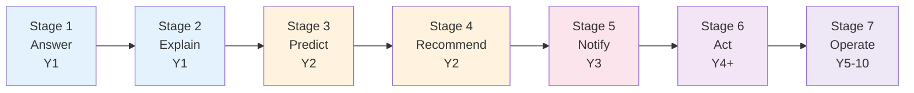

| Stage | Capability | Proof point that unlocks the next stage |
|---|---|---|
| 1. Answer | Natural language → governed metric → correct number | >95% metric-resolution accuracy on customer eval set |
| 2. Explain | Metric movement → ranked, tested causes | Analysts stop re-checking our root causes |
| 3. Predict | Forecasts with intervals; leading indicators | Forecast MAPE beats the customer's spreadsheet |
| 4. Recommend | Actions with expected impact and risk | Recommendations get adopted and tracked |
| 5. Notify | Proactive, low-false-positive alerting | Alert acceptance rate >40% (this is the hard one) |
| 6. Act | Executes reversible actions with approval | Zero unauthorized writes over 12 months |
| 7. Operate | Runs closed-loop business processes | See Part 23 |

The end state is not a better dashboard. It is a **synthetic member of the executive team** that has read everything, remembers everything, and never sleeps. Part 23 develops this.

---

# Part 2 — User Personas

Personas here are not marketing artifacts. Each one determines a concrete engineering requirement — a connector, a memory type, a latency budget, or a permission model. I have marked the ICP explicitly, because at pre-seed you cannot build for twelve personas and the failure mode of this document is pretending you can.

**Design for the Founder/CEO of a 20–200 person e-commerce or B2B SaaS company first.** They feel the pain daily, they can buy without a committee, their data is small enough to be tractable, and they have no analyst to be threatened by us. Everything else is expansion.

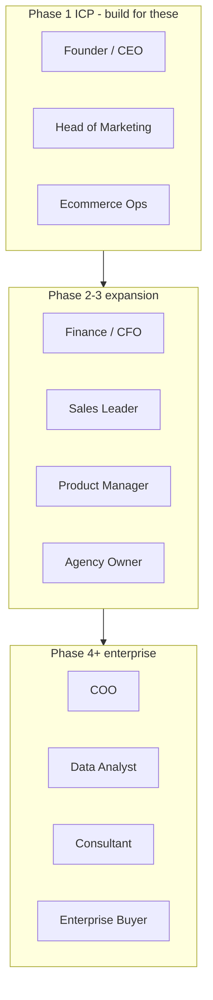

## 2.1 Founder / CEO — **primary ICP**

**Context.** 20–200 employees. Runs the company from a mix of intuition, a Stripe dashboard, a Google Sheet, and whatever the last person told them.

**Problems.** They are structurally the *last* person to learn bad news. Every number they receive has passed through someone with an incentive. They cannot get an answer at 11pm on Sunday when they are preparing for a board call. Their questions are cross-functional — spanning ads, product, support, and finance — and therefore nobody in the company owns the answer.

**Goals.** Know what's actually happening. Catch problems before the board does. Allocate capital and attention correctly.

**Daily workflow.** Morning: check revenue, cash, pipeline. Ad hoc: react to something alarming. Weekly: leadership meeting. Monthly: board update. Their real job is *deciding what to worry about*.

**Questions they ask.**
- "Why did revenue drop last week?"
- "Are we still on plan for the quarter?"
- "What changed since yesterday that I should know about?"
- "Is our CAC problem a channel problem or a conversion problem?"
- "What would you be worried about if you were me?"

**Engineering implications.** ⇒ Mobile-quality responsive UI. Daily digest as the core habit loop (Part 16). Cross-source joins are mandatory, not optional — this persona's questions *always* span Stripe + ads + product. Answers must be executive-legible: three sentences, one chart, one recommendation.

## 2.2 COO / Head of Operations

**Problems.** Owns a dozen operational metrics that nobody watches continuously. Failures are discovered late, usually by a customer. Data lives in six operational systems that were never designed to be joined.

**Goals.** Zero surprises. Find the process step that is degrading. Push accountability down with evidence rather than opinion.

**Daily workflow.** Ops standup, exception review, firefighting, weekly business review prep.

**Questions.** "Which fulfillment center is degrading?" · "Why did average handle time jump?" · "Where in the funnel are we losing operational efficiency?" · "Is this a systems problem or a staffing problem?"

**Engineering implications.** ⇒ Segment/cohort drill-down must go 3+ dimensions deep. Operational connectors (Zendesk, Jira, warehouse systems). Hourly rather than daily freshness for some metrics.

## 2.3 Head of Marketing / CMO

**Problems.** Attribution is broken and everyone knows it. Platform-reported ROAS is self-graded and inflated. Blended CAC drifts and the cause is never obvious. They spend hours reconciling Meta, Google, GA4, and the actual revenue system.

**Goals.** Defend budget with credible numbers. Kill losing campaigns fast. Explain CAC movement to the CEO before being asked.

**Daily workflow.** Morning platform check, mid-week budget reallocation, weekly channel review, monthly board slide.

**Questions.** "Which campaigns are failing?" · "Why is CAC up 22%?" · "Is this creative fatigue or audience saturation?" · "What's my real blended CAC vs. what the platforms claim?" · "Which channel should the next $50k go to?"

**Engineering implications.** ⇒ **This persona alone justifies the multi-source join architecture.** Ads connectors with cost/impression/click grain, plus revenue truth from Stripe/Shopify. Requires a first-class *contribution analysis* on CAC = spend / new customers, decomposed by channel and campaign. Highest willingness to pay in the ICP.

## 2.4 Finance / CFO / FP&A

**Problems.** Lives in a spreadsheet that breaks. Month-end variance analysis is manual archaeology. Cannot answer "why is gross margin down 140bps" without three days of work.

**Goals.** Close faster. Explain variance credibly. Forecast cash without heroics.

**Daily workflow.** Close cycle, variance analysis, forecast maintenance, board reporting.

**Questions.** "Why did gross margin compress?" · "Actual vs. plan by line item, and what drove the gap?" · "What's our cash runway under three scenarios?" · "Which customers are behind on payment and materially so?"

**Engineering implications.** ⇒ **Correctness bar is absolute for this persona** — one wrong number and they are gone forever. Requires budget/plan data as a first-class input (Part 6 `metric_targets`). Requires exportable, auditable workpapers. Variance decomposition (price × volume × mix) is the killer feature.

## 2.5 Sales Leader / CRO

**Problems.** Pipeline data is dirty because reps enter it. Forecast is a gut feel dressed as a number. Cannot tell whether a slow quarter is a top-of-funnel problem or a closing problem until it's over.

**Goals.** Accurate forecast. Diagnose stage conversion. Find the coachable behavior.

**Questions.** "Why did the pipeline shrink?" · "Which stage is leaking?" · "Which reps are off trajectory and why?" · "Is this a volume problem or a win-rate problem?"

**Engineering implications.** ⇒ CRM connectors with historical snapshotting (Salesforce/HubSpot mutate records in place — you must capture state over time or you cannot compute stage-transition rates). Funnel and cohort primitives.

## 2.6 Product Manager

**Problems.** Product analytics tools show behavior but not revenue impact. Feature adoption ≠ business value. Experiment readouts take a week.

**Goals.** Tie product changes to business metrics. Find where users stall. Prioritize with evidence.

**Questions.** "Which product category is slowing growth?" · "Did the new onboarding move activation?" · "Which cohort retains and what did they do differently in week 1?" · "What's the revenue impact of that bug?"

**Engineering implications.** ⇒ Cohort and retention primitives. Event-data connectors. Experiment history in memory (Part 11).

## 2.7 Data Analyst — **the gatekeeper**

Treat this persona carefully. In any company with a data team, **they will decide whether we live or die**, and their instinct will be suspicion.

**Problems.** Drowning in ad-hoc requests that are beneath their skill level. Constantly asked the same five questions. Cannot do strategic work.

**Goals.** Deflect ad-hoc requests. Retain control over metric definitions. Not be blamed when an AI gives the CEO a wrong number.

**Questions they ask *of us*.** "Where did that number come from?" · "Which table did you join?" · "Did you handle refunds/test accounts/timezones?" · "Can I override the definition?"

**Engineering implications.** ⇒ **Full SQL transparency, always.** Semantic layer authoring is *their* tool — they own definitions, we consume them. Import from dbt/LookML so their existing work carries over. A "certified metric" concept so they can vouch for definitions. Give them an admin surface where they see every question asked and can correct wrong answers (which becomes training signal — see Part 11.6).

## 2.8 Agency Owner

**Problems.** Manages 10–50 client accounts. Reporting is a monthly fire drill that consumes junior staff. Client churn happens when performance dips and the agency notices late.

**Goals.** Automate client reporting. Detect account problems before the client does. Scale accounts per employee.

**Questions.** "Which client accounts are underperforming this month?" · "Generate the November report for all 30 clients." · "Which accounts are at churn risk?"

**Engineering implications.** ⇒ **Multi-workspace architecture from day one** — one login, N isolated client workspaces. Bulk/templated report generation. White-labeling. This persona is an excellent early revenue source: high pain, fast sales cycle, and they resell us implicitly.

## 2.9 Management Consultant

**Problems.** Every engagement starts with weeks of manual data assembly. Diligence timelines are brutal.

**Goals.** Compress time-to-insight on a new dataset. Produce defensible client deliverables.

**Questions.** "What are the three biggest problems in this business?" · "Where's the margin leakage?" · "Benchmark this against the sector."

**Engineering implications.** ⇒ Fast cold-start on unfamiliar schemas (auto-profiling, Part 8.7). Export to PowerPoint/Word. Ephemeral project workspaces.

## 2.10 Enterprise Buyer (VP Data / CIO)

**Problems.** Has invested millions in a warehouse and BI stack that executives do not use. Adoption is 12%. Under pressure to show AI value without creating a governance incident.

**Goals.** Increase data ROI. No data leaves the perimeter. Pass security review.

**Questions.** "Where does our data go?" · "Can this run in our VPC?" · "SOC 2? Sub-processors? Does our data train your models?" · "Does it respect our existing row-level security?"

**Engineering implications.** ⇒ SSO/SCIM, VPC/PrivateLink connectivity, BYOK, data residency, SOC 2 Type II, zero-retention LLM agreements, warehouse-credential pass-through so their RLS applies natively. Every one of these is a Phase 4 item — but the *schema* must not preclude them, which is why `organizations` carries isolation metadata from commit one.

## 2.11 Persona → requirement traceability

| Requirement | Driven by |
|---|---|
| Cross-source joins | Founder, Marketing, Finance |
| Daily digest / proactive alerts | Founder, COO, Agency |
| Semantic layer with certification | Analyst, Finance, Enterprise |
| Historical CRM snapshotting | Sales |
| Multi-workspace | Agency, Consultant, Enterprise |
| SQL transparency & lineage | Analyst, Finance, Enterprise |
| Variance decomposition | Finance, Marketing |
| Cohort/retention primitives | Product, Founder |
| VPC deployment, BYOK | Enterprise |
| Export to PPTX/XLSX | Consultant, Finance, Agency |

---

# Part 3 — System Architecture

## 3.1 The governing decision: modular monolith, not microservices

With three engineers, microservices are a tax with no benefit. You get distributed transactions, network failure modes, twelve deploy pipelines, and no ability to refactor across boundaries — in exchange for independent scaling you do not need at 40 customers.

**Decision: one Python application, strictly partitioned into modules with enforced import boundaries, deployed as three process types** (API, worker, scheduler) from a single container image.

The enforcement matters. Without it "modular monolith" degrades into "monolith." We enforce it with `import-linter` in CI (Part 19.3), with contracts that prevent, for example, `agents/` from importing `api/`, or any module from importing another module's internals rather than its public interface. When a module needs to become a service in year two, the extraction is mechanical because the boundary was already real.

The one exception: **query execution runs in a separate, hardened process pool** from day one, because it executes generated SQL against customer credentials and needs a different blast radius, different timeouts, and different network egress rules than the API.

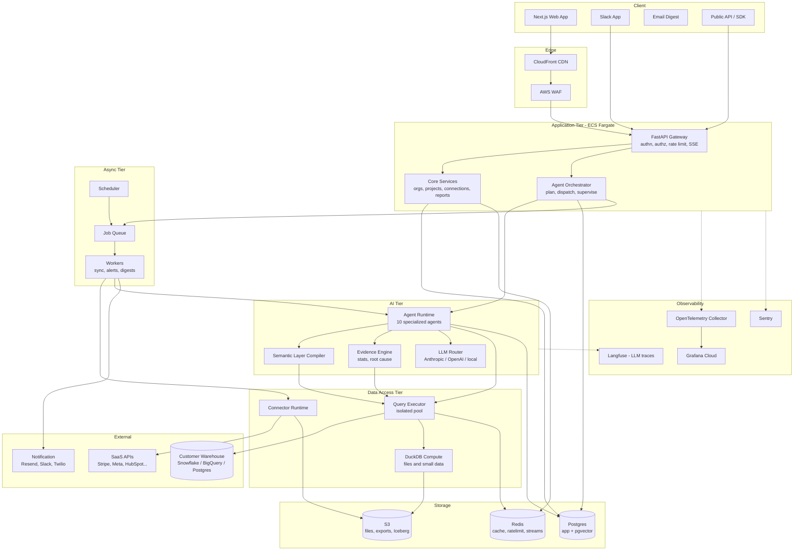

## 3.2 Component-by-component

### Frontend
Next.js App Router, server components for shell and data-light pages, client components for the investigation canvas. The critical UI object is the **Investigation View**: question at top, streaming narrative, evidence cards, charts, and a collapsible "show your work" trace. Streaming is over **SSE, not WebSockets** — the traffic is unidirectional server→client, SSE survives proxies and load balancers better, reconnects natively, and needs no separate connection manager. WebSockets only arrive if we build multiplayer editing.

### API Gateway `[P1: in-process]`
Phase 1 the gateway is FastAPI middleware, not a separate product: JWT verification, org-scoping, rate limiting via Redis token bucket, request ID propagation, and idempotency keys on all mutating routes. Do not buy Kong/Apigee at pre-seed; you will spend a week configuring an ingress you could have written in 200 lines. `[P4]` Move to an ALB + dedicated gateway when you need per-partner quota tiers and multi-region.

### Agent Orchestrator
The heart of the system. Receives a question, produces a **Plan** (a DAG of agent steps), dispatches steps, supervises retries and budgets, streams progress, and persists the whole run. Every run is a durable state machine — an agent run must survive a deploy. Phase 1 this is a Postgres-backed state machine with an `investigation_steps` table; `[P3]` this becomes Temporal workflows (Part 4.7).

### Query Executor — isolated
Runs in its own process pool with:
- Per-org connection pools using the org's warehouse credentials
- Hard statement timeouts and byte-scanned limits
- A read-only guarantee enforced at the **AST level** via SQLGlot before execution, plus a read-only DB role as defence in depth
- Result capping (default 50k rows to Arrow, aggregates only to the LLM)
- Circuit breakers per connection

### Semantic Layer Compiler
Takes `metric + dimensions + filters + grain` and emits dialect-correct SQL. This is deterministic code, not an LLM. See Part 8.

### Evidence Engine
Deterministic statistics: anomaly detection, decomposition, correlation, contribution. Emits `Finding` rows. See Part 12.

### Memory `[P1: Postgres + pgvector]`
Three tiers — working (in-run), episodic (investigations, decisions), semantic (business knowledge, glossary, OKRs). See Part 11.

### Event bus `[P1: Postgres outbox → Redis Streams]` `[P4: Kafka]`
You do not need Kafka. You need at-least-once delivery of domain events to a handful of consumers. Phase 1: a transactional **outbox table** in Postgres, drained by a worker into **Redis Streams** with consumer groups. This gives ordering per stream, consumer groups, replay, and a dead-letter list — 95% of Kafka's value for 2% of the operational cost. Move to Redpanda/Kafka when you have >5 independent consumer teams or need multi-day replay at volume.

### Notification service
A single `notifications` module with pluggable channels (email/Resend, Slack, webhook, SMS), a rendering layer, user preference and quiet-hours enforcement, and per-user digest batching. Critically, **alert suppression logic lives here** (Part 16.5), not in the alert detector — one place to decide "has this person already been told."

## 3.3 Request lifecycle — the core sequence

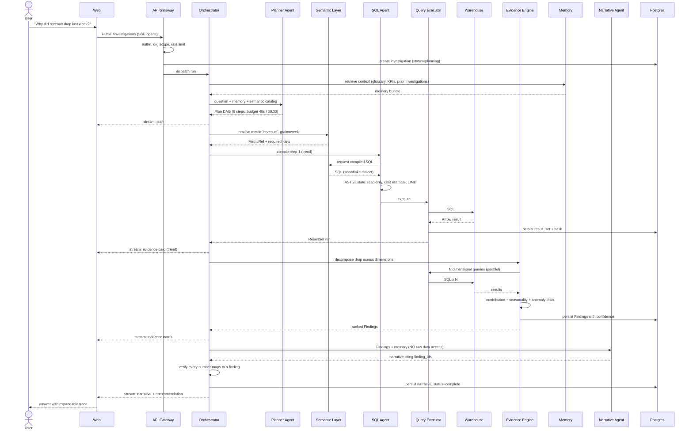

Note the verification step before persistence: the orchestrator parses the narrative, extracts every numeric token, and asserts each one appears in the cited `Finding` payloads within tolerance. Failing that check triggers a regeneration with a stricter prompt, and after two failures the system returns the evidence cards *without* narrative rather than risk a fabricated number. **Degrading to less prose is always better than degrading to wrong prose.**

## 3.4 Data flow — ingestion vs. federation

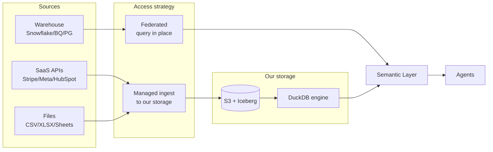

**Rule:** if the customer has a warehouse, we query it in place and never copy. If the data is in a SaaS API or a file, we must materialize it — but into *our* object storage as Iceberg tables queried by DuckDB, and `[P3]` optionally we write it into *their* warehouse instead, which is strictly better for enterprise sales because it means we hold no customer data at rest.

## 3.5 Multi-tenancy model

**Decision: shared database, shared schema, row-level tenancy via `org_id` on every table, enforced by Postgres RLS with a session variable — not by application code.**

```sql
ALTER TABLE investigations ENABLE ROW LEVEL SECURITY;
CREATE POLICY org_isolation ON investigations
  USING (org_id = current_setting('app.current_org_id')::uuid);
```

The application sets `app.current_org_id` once, in a middleware-scoped transaction. Application-level filtering is one forgotten `WHERE` clause away from a cross-tenant data leak, and that single incident ends an enterprise-focused company. RLS makes the leak impossible by construction and costs one line per table.

`[P4]` For enterprises demanding physical isolation: a `deployment_tier` column on `organizations` routing to a dedicated database or a single-tenant cell. Design the connection layer as `get_engine(org)` from commit one so this is a routing change, not a rewrite.

## 3.6 Failure domains and degradation ladder

| Failure | Blast radius | Behaviour |
|---|---|---|
| LLM provider down | New investigations | Router fails over to secondary provider; cached answers still served |
| Customer warehouse down | That org only | Serve cached result sets with staleness banner; queue investigation for retry |
| Redis down | Cache + rate limit | Degrade to uncached; rate limit fails open with a global concurrency cap |
| Postgres primary down | Everything | Read replica serves read-only mode; investigations queue |
| Worker pool saturated | Async jobs | Priority queue: interactive > alert > sync > backfill |
| Evidence engine error on a dimension | One finding | Skip that dimension, mark trace, continue — never fail the whole investigation |
| Narrative verification fails twice | One answer | Return evidence cards without prose |

The last two encode a philosophy: **partial answers with honest gaps beat total failure, and both beat confident fabrication.**

---

# Part 4 — Tech Stack

Every row below is a decision with a reason. Where I list a rejected alternative, that is the option I expect you to be tempted by.

## 4.1 Frontend

| Concern | Choice | Why | Rejected |
|---|---|---|---|
| Framework | **Next.js 15, App Router, TypeScript** | Streaming SSR matches our streaming product; one deployable; the largest hiring pool of any frontend stack | Remix (smaller ecosystem), SPA + separate CDN (worse first paint, more moving parts) |
| Styling | **Tailwind + shadcn/ui** | You own the component source, so you can restyle for white-label without fighting a design system. Zero runtime CSS-in-JS cost | MUI (heavy, opinionated, hard to white-label), Chakra |
| Server state | **TanStack Query** | Correct cache invalidation semantics for a data product; request dedup; optimistic updates | SWR (thinner), Redux (wrong tool) |
| Client state | **Zustand** | ~1kb, no provider ceremony; we have little global state | Redux Toolkit (ceremony) |
| **Charts** | **Vega-Lite** ⟵ *the important one* | Charts are **generated by an agent**. Vega-Lite is a declarative JSON grammar, which means the Visualization Agent emits a spec that we can **validate against a schema before rendering** — impossible with imperative chart APIs. It also serializes cleanly into the DB, renders server-side to PNG for emails/PDFs from the same spec, and covers the full grammar of graphics | Recharts/Chart.js (imperative — an LLM would have to emit React code, which is unvalidatable and a security hazard), Plotly (heavy, licensing friction), D3 raw (too low-level to generate) |
| Tables | **TanStack Table + virtualization** | Headless, 100k-row virtual scroll, we control the styling | AG Grid (license cost at scale) |
| Forms | React Hook Form + Zod | Zod schemas shared with API contract generation | Formik |
| Testing | Vitest + Playwright | Speed; Playwright for the streaming-investigation E2E path | Cypress (slower) |

**The Vega-Lite decision is load-bearing.** If you take one frontend recommendation from this document, take that one: *never let an LLM generate imperative rendering code*. Generate a declarative spec, validate it against a JSON schema, reject on failure, render deterministically.

## 4.2 Backend

| Concern | Choice | Why | Rejected |
|---|---|---|---|
| Language | **Python 3.12 everywhere** | The AI, statistics, and data ecosystem is Python. A Node API + Python AI service means two deploy paths, two dependency systems, and a serialization boundary in the hottest code path — for three engineers that is unaffordable | Node/TypeScript backend (would force a split), Go (no stats ecosystem) |
| Framework | **FastAPI** | Async-native (our workload is IO-bound on warehouses and LLMs), Pydantic-native so request/response/LLM-output validation share one type system, auto-generated OpenAPI → typed frontend client | Django (sync-first, ORM too coupled), Flask (assembly required), Litestar (smaller ecosystem) |
| Server | Uvicorn + Gunicorn workers | Standard, battle-tested | Granian (immature) |
| Validation | **Pydantic v2** | Same models validate HTTP input *and* LLM structured output — this is a genuine architectural simplification, not a convenience | attrs, dataclasses |
| ORM | **SQLAlchemy 2.0 + Alembic** | The only Python ORM that lets you drop to raw SQL without leaving the session, which we do constantly. Alembic migrations are non-negotiable | SQLModel (leaky at complexity), Prisma Python (immature), Tortoise |
| Task/queue `[P1]` | **arq** (Redis) or Postgres-backed queue | Async-native, tiny, readable source | **Celery — rejected for P1.** Sync-first, heavyweight config, poor asyncio story, and its failure modes are notoriously hard to debug. If you already know Celery deeply, use it; otherwise arq |
| Durable workflows `[P3]` | **Temporal Cloud** | Agent runs are long-lived multi-step processes that must survive deploys and be resumable/replayable. This is exactly Temporal's problem. Use Cloud — do not self-host a Temporal cluster with three engineers | Step Functions (AWS-locked, poor local dev), homegrown state machine beyond P2 |

### The LLM orchestration decision

| Concern | Choice | Why |
|---|---|---|
| Orchestration | **In-house, ~1500 lines, over vendor SDKs** | **Do not use LangChain.** For an agent system where correctness, cost control, and traceability are the product, framework abstraction actively hurts: you cannot see the prompt, you cannot control retry semantics, you inherit breaking changes, and debugging goes through three layers of indirection. What you actually need is: a typed message loop, tool dispatch, structured output parsing, retry/fallback, and token accounting. That is a few days of work you will understand forever |
| Provider routing | **LiteLLM** (library, not proxy) | Uniform interface across Anthropic/OpenAI/Bedrock, so failover and per-task model selection are config, not code |
| Structured output | Pydantic + provider tool-use/JSON mode | Model output validated by the same schemas as our API |
| Prompt management | **Versioned files in the repo + Langfuse for traces** | Prompts are code. They belong in git, in code review, tied to an eval run — not in a SaaS UI where they mutate untracked |
| Evals | **Promptfoo + custom eval harness in CI** | Every prompt change runs against a golden set of questions with known-correct answers before merge. See Part 19.4 |
| Agent framework | None | See above. `[P4]` reconsider if a standard emerges with real observability |

## 4.3 Data & query layer

| Concern | Choice | Why | Rejected |
|---|---|---|---|
| App DB | **Postgres 16** (Neon `[P1]` → RDS Aurora `[P3]`) | RLS for tenancy, JSONB for semi-structured agent state, pgvector for embeddings, LISTEN/NOTIFY for events, and excellent time-series behaviour with partitioning. Neon's branching gives every PR a real database | MySQL (weaker JSON/RLS), MongoDB (we need joins and constraints) |
| **SQL parsing/generation** | **SQLGlot** ⟵ *the second load-bearing choice* | Parses, validates, transpiles and rewrites SQL as an AST across 20+ dialects. This gives us: (a) **security** — prove a generated query contains no DML/DDL before executing, at the AST level rather than by regex; (b) **portability** — write semantic layer logic once, emit Snowflake/BigQuery/Postgres/DuckDB; (c) **safety rails** — programmatically inject `LIMIT`, tenant filters, and time bounds; (d) **lineage** — extract referenced tables/columns for the audit log | Regex validation (trivially bypassed — `; DROP` in a comment, unicode tricks), per-dialect handwritten SQL (unmaintainable) |
| Local compute | **DuckDB** | Query CSV/Parquet/Iceberg at analytical speed in-process. Powers file uploads, cross-source joins, and small-customer mode with zero infrastructure. An underrated startup superpower | Spark (absurd at this scale), Pandas (memory-bound, no SQL) |
| Wire format | **Apache Arrow** | Zero-copy between warehouse driver → executor → DuckDB → serialization. Avoids the Pandas conversion tax | JSON (10x slower, type-lossy) |
| Vector store `[P1]` | **pgvector in the app DB** | At <10M vectors, a separate vector DB is pure operational overhead. HNSW in pgvector is fast enough, and crucially you can **join vectors to relational rows in one query** — "find similar past investigations *for this org* *about this metric*" is a hybrid query, and that is where dedicated vector DBs get painful | Pinecone (cost, another vendor, no joins), Weaviate/Qdrant (`[P4]` reconsider past 50M vectors) |
| Object storage | **S3** + **Apache Iceberg** | Iceberg gives schema evolution, time travel, and — decisively — it is readable by Snowflake, BigQuery, Databricks and DuckDB alike, so materialized data is never trapped in our format | Raw Parquet (no evolution/ACID), Delta (weaker non-Spark support) |
| Search | **Postgres FTS + pgvector hybrid** | Reciprocal-rank-fusion of BM25 and vector search beats either alone for our corpora, at zero extra infrastructure | Elasticsearch (an operational full-time job), Typesense (`[P4]`) |
| Cache | **Redis** (Upstash `[P1]` → ElastiCache `[P3]`) | Query result cache, rate limiting, Streams event bus, session data | Memcached (no data structures) |
| ETL | **In-house connector SDK, Singer-protocol compatible** | Sync semantics must be tightly coupled to the semantic layer and freshness metadata; an opaque third-party sync tool cannot tell our agents what "fresh" means. Singer-protocol compatibility means we can absorb hundreds of community taps as an escape hatch | Fivetran (cost destroys unit economics; also a competitor-adjacent dependency), Airbyte self-hosted (heavy) |

## 4.4 Infrastructure

| Concern | `[P1]` choice | `[P4]` end state | Why |
|---|---|---|---|
| Cloud | **AWS** | AWS | Enterprise buyers trust it; PrivateLink for private warehouse connectivity is a real sales unblocker; AWS Marketplace lets enterprises buy with committed spend. GCP is fine technically but the marketplace/procurement story is weaker |
| Compute | **ECS Fargate** | EKS | **Do not run Kubernetes with three engineers.** Fargate gives you containers, autoscaling, and rolling deploys with roughly zero cluster operations. The migration to EKS later is a Terraform change plus manifests, because your app is already containerized and stateless. Kubernetes at pre-seed is a full-time SRE job you cannot staff |
| IaC | **Terraform + Terragrunt** | same | Everything in code from day one. This is not premature — recreating an environment by hand during an incident is how outages become disasters |
| Containers | **Docker, multi-stage, distroless base** | same | Small images, small CVE surface |
| CDN/WAF | CloudFront + AWS WAF | same | Bot protection and geo controls that show up in security questionnaires |
| Secrets `[P1]` | **AWS Secrets Manager** + SOPS for config | + HashiCorp Vault `[P4]` for BYOK | Customer warehouse credentials are the crown jewels. Never in env vars, never in the app DB unencrypted. Encrypted per-org with a KMS data key (Part 17.4) |
| CI/CD | **GitHub Actions** | + Argo `[P4]` | Where the code is; OIDC to AWS means no long-lived cloud keys |

## 4.5 Observability

| Concern | Choice | Why |
|---|---|---|
| Tracing/metrics/logs | **OpenTelemetry → Grafana Cloud** | One vendor-neutral instrumentation layer. If Grafana gets expensive you change an endpoint, not your code. Datadog is better UX and 4–8x the price — revisit at Series A |
| Errors | **Sentry** | Nothing else is close for stack-trace triage |
| **LLM observability** | **Langfuse** | Traces every agent step, prompt version, token cost, and latency; supports scoring/eval datasets; OTel-compatible; self-hostable if an enterprise demands it. **Non-negotiable** — without per-step LLM tracing you cannot debug a 12-step agent run or explain your COGS |
| Product analytics + **feature flags** + session replay | **PostHog** | Replaces three vendors (Amplitude + LaunchDarkly + FullStory) with one, is self-hostable for enterprise, and its session replay is how you will actually learn why users abandon investigations |
| Uptime | Better Stack | Cheap, good status pages |

## 4.6 Third-party services

| Concern | Choice | Why | Rejected |
|---|---|---|---|
| **Auth** | **WorkOS AuthKit** | You get email/password, social, **and SAML SSO + SCIM directory sync** on one bill. Enterprise SSO is a hard requirement that arrives suddenly with your first six-figure deal; building SAML yourself is 4–8 weeks of misery. WorkOS is the single highest-leverage buy on this list | Auth0 (pricing cliffs are brutal), Clerk (weaker enterprise SSO/SCIM), Supabase Auth (fine, but SSO story is thin), roll-your-own (do not) |
| Billing | **Stripe Billing + Orb `[P3]`** | Stripe for seats; add Orb when you need usage-based metering on investigations/tokens, which you will, because LLM COGS is variable | Chargebee, homegrown metering |
| Email | **Resend** + React Email | Digests are a core surface; React Email means the same components render web and email | SendGrid (deliverability admin burden) |
| Docs/PPTX export | python-docx, python-pptx, WeasyPrint | Consultant and Finance personas require it | — |

## 4.7 Why `[P1]` deliberately omits Kafka, Kubernetes, Celery, Airflow and a vector DB

Everything on that list solves a problem you will have at 10,000 customers and will not have at 40. Each costs roughly one engineer-month to introduce and 10–20% of an engineer forever to operate. With three engineers, adopting all five means you have zero engineers building the product.

The discipline is: **build the interface now, the implementation later.**

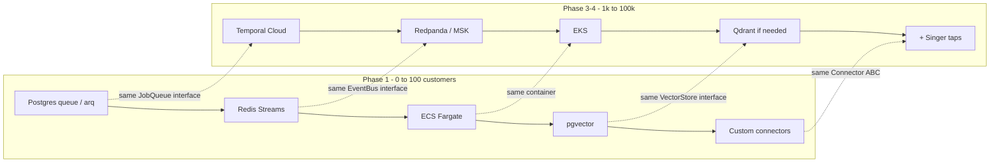

Concretely, `shared/interfaces/` defines `JobQueue`, `EventBus`, `VectorStore`, `ObjectStore`, and `LLMProvider` as protocols. Every call site depends on the protocol. Swapping the implementation is a factory change and an integration test.

---

# Part 5 — Folder Structure

A monorepo. One version of truth for the API contract, one CI pipeline, atomic cross-cutting changes. Split it when you have separate teams, not before.

```
fred-ai/
├── apps/
│   ├── web/                      # Next.js — the only user-facing app
│   │   ├── app/                  # App Router. Route groups: (auth) (app) (public)
│   │   │   ├── (app)/
│   │   │   │   ├── ask/          # investigation canvas — the core surface
│   │   │   │   ├── investigations/[id]/
│   │   │   │   ├── metrics/      # semantic layer browser + editor
│   │   │   │   ├── connections/  # connector setup + sync health
│   │   │   │   ├── alerts/
│   │   │   │   └── settings/     # org, members, billing, API keys
│   │   │   └── api/              # BFF only: auth callbacks, SSE proxy. NO business logic
│   │   ├── components/
│   │   │   ├── ui/               # shadcn primitives
│   │   │   ├── charts/           # Vega-Lite renderer + spec validator
│   │   │   ├── evidence/         # evidence cards, trace viewer, SQL viewer
│   │   │   └── investigation/    # streaming narrative, plan progress
│   │   ├── lib/
│   │   │   ├── api/              # generated typed client from OpenAPI — never hand-written
│   │   │   └── sse/              # reconnecting event source
│   │   └── e2e/                  # Playwright
│   │
│   └── api/                      # FastAPI — the modular monolith
│       ├── main.py               # app factory, lifespan, middleware chain
│       ├── routers/              # HTTP only: parse, authorize, delegate, serialize
│       │   ├── investigations.py
│       │   ├── metrics.py
│       │   ├── connections.py
│       │   ├── alerts.py
│       │   ├── webhooks.py       # inbound: Stripe, Slack, connector callbacks
│       │   └── public_v1.py      # versioned public API — separate schemas, never leak internals
│       ├── middleware/           # auth, org context (sets RLS var), ratelimit, request id, idempotency
│       ├── schemas/              # Pydantic request/response DTOs — NOT the DB models
│       └── deps.py               # FastAPI dependency providers
│
├── services/                     # Business logic. Framework-free. Importable by API and workers alike.
│   ├── semantic/                 # ── Part 8 ──
│   │   ├── models.py             # Metric, Dimension, Entity, Join, TimeGrain
│   │   ├── loader.py             # parse+validate YAML metric definitions
│   │   ├── compiler.py           # (metric, dims, filters, grain) -> SQLGlot AST
│   │   ├── dialects/             # snowflake, bigquery, postgres, duckdb emitters
│   │   ├── resolver.py           # natural language -> MetricRef (hybrid retrieval)
│   │   ├── importers/            # dbt, LookML, Cube adapters
│   │   └── profiler.py           # auto-discover schema, propose metrics
│   ├── query/                    # ── query execution ──
│   │   ├── executor.py           # isolated pool, timeouts, retries, circuit breaker
│   │   ├── validator.py          # AST guards: read-only, cost, limits, tenant filter
│   │   ├── cache.py              # result cache keyed by (org, sql_hash, freshness)
│   │   ├── engines/              # snowflake, bigquery, postgres, mysql, duckdb adapters
│   │   └── result.py             # Arrow ResultSet + persistence + hashing
│   ├── evidence/                 # ── Part 12 — the moat ──
│   │   ├── anomaly.py            # STL + robust z-score, seasonal ESD, changepoint
│   │   ├── decomposition.py      # mix-shift / contribution across dimensions
│   │   ├── correlation.py        # lagged correlation with multiple-testing control
│   │   ├── causal.py             # CausalImpact / diff-in-diff  [P3]
│   │   ├── confidence.py         # the scoring rubric — single source of truth
│   │   └── ranking.py            # evidence ranking and dedup
│   ├── forecast/                 # ── Part 14 ──
│   ├── memory/                   # ── Part 11 ──
│   │   ├── episodic.py           # investigations, decisions, corrections
│   │   ├── semantic_mem.py       # glossary, OKRs, company facts
│   │   ├── retrieval.py          # hybrid search + recency + importance scoring
│   │   └── consolidation.py      # periodic summarization/decay job
│   ├── connectors/               # ── Part 7 ──
│   │   ├── base.py               # Connector ABC — the plugin contract
│   │   ├── registry.py           # discovery + capability manifest
│   │   ├── auth/                 # oauth2 flows, token refresh, key vault access
│   │   ├── sync/                 # incremental engine, cursors, backfill, dedup
│   │   ├── ratelimit.py          # per-provider adaptive limiter
│   │   └── providers/            # one package per source: stripe/, meta_ads/, hubspot/...
│   ├── alerts/                   # ── Part 16 ──
│   ├── recommendations/          # ── Part 13 ──
│   ├── viz/                      # ── Part 15: chart selection + Vega-Lite spec builder ──
│   ├── billing/
│   ├── notifications/            # channels, templates, preferences, suppression
│   └── iam/                      # orgs, users, roles, permissions, API keys
│
├── agents/                       # ── Part 10 ──
│   ├── runtime/
│   │   ├── loop.py               # the ~400-line agent loop. Read this file first.
│   │   ├── tools.py              # tool registry, schema gen, dispatch, sandboxing
│   │   ├── budget.py             # token/time/cost budget enforcement per run
│   │   ├── router.py             # LiteLLM model selection per task class
│   │   └── trace.py              # Langfuse span emission
│   ├── orchestrator/
│   │   ├── planner.py            # question -> Plan DAG
│   │   ├── supervisor.py         # dispatch, retry, degrade, stream
│   │   └── verifier.py           # narrative-vs-evidence numeric check
│   ├── definitions/              # one module per agent: sql, root_cause, forecast, viz, ...
│   ├── prompts/                  # versioned .md/.j2 prompt templates — git is the CMS
│   └── evals/
│       ├── datasets/             # golden questions + expected metrics/SQL/findings
│       └── scorers/              # metric-resolution acc, SQL exec acc, numeric fidelity
│
├── workers/                      # thin async entry points; logic lives in services/
│   ├── worker.py                 # queue consumer
│   ├── scheduler.py              # cron definitions
│   └── tasks/                    # sync_connector, run_alerts, daily_digest, consolidate_memory
│
├── pipelines/                    # data engineering
│   ├── ingest/                   # connector -> Iceberg landing
│   ├── transform/                # normalization to canonical entities
│   ├── quality/                  # freshness, volume, schema-drift, null-rate checks
│   └── dbt/                      # optional customer-facing transformations
│
├── shared/                       # imported by everything; imports nothing internal
│   ├── db/
│   │   ├── models/               # SQLAlchemy models (the ONLY definition of tables)
│   │   ├── session.py            # session factory, org-scoped RLS transaction helper
│   │   └── migrations/           # Alembic
│   ├── interfaces/               # Protocols: JobQueue, EventBus, VectorStore, LLMProvider
│   ├── events/                   # event schemas + outbox publisher
│   ├── errors/                   # typed exception hierarchy -> HTTP mapping
│   ├── telemetry/                # OTel setup, structured logging, metric helpers
│   ├── security/                 # crypto, PII redaction, token utils
│   └── types/                    # domain enums and value objects
│
├── infra/
│   ├── terraform/
│   │   ├── modules/              # network, ecs, rds, redis, s3, iam, observability
│   │   └── envs/{dev,staging,prod}/
│   ├── docker/                   # Dockerfile.api, Dockerfile.worker, Dockerfile.web
│   └── k8s/                      # [P4] manifests — empty until then
│
├── deployment/
│   ├── github-actions/           # reusable workflows
│   ├── scripts/                  # migrate, seed, rollback, dr-restore
│   └── runbooks/                 # incident procedures — write these BEFORE the incident
│
├── tests/
│   ├── unit/
│   ├── integration/              # testcontainers: real Postgres, Redis, DuckDB
│   ├── e2e/
│   ├── evals/                    # AI quality gates that run in CI
│   ├── load/                     # k6 scenarios
│   └── fixtures/                 # synthetic company datasets w/ known ground truth
│
├── configs/
│   ├── settings.py               # Pydantic Settings — single source of config truth
│   ├── metrics/                  # bundled starter metric packs (saas.yaml, ecommerce.yaml)
│   ├── prompts.yaml              # prompt version pinning
│   └── flags.yaml                # feature flag defaults
│
├── scripts/                      # dev tooling: seed_demo, replay_investigation, cost_report
├── docs/
│   ├── BLUEPRINT.md              # this document
│   ├── adr/                      # architecture decision records — one per hard call
│   ├── api/                      # generated OpenAPI
│   └── runbooks/
├── docker-compose.yml            # full local stack: api, worker, web, pg, redis, minio
├── Makefile                      # make dev, make test, make eval, make migrate
└── pyproject.toml                # uv-managed
```

## 5.1 Why the boundaries are where they are

**`apps/` vs `services/`** — the single most important split. `apps/api/routers/` may contain *no* business logic: it parses, authorizes, delegates to a service, serializes. This is what lets a worker, a scheduled job, a Slack handler, and an HTTP request all invoke the same investigation logic without duplication, and it is what makes the API layer trivially testable.

**`services/` is framework-free.** No FastAPI imports, no HTTP concepts, no `Request` objects. Enforced by import-linter. When you extract `services/evidence/` into its own deployment in year two, it ports unchanged.

**`agents/` is separate from `services/`** — agents are *non-deterministic* code with fundamentally different testing (evals, not asserts), different observability (traces, not logs), and different failure semantics (degrade, not raise). Mixing them with deterministic services blurs where you can trust the output. **The rule: agents may call services; services may never call agents.** A service that calls an LLM is a service you can no longer unit test.

**`services/evidence/` is deliberately isolated and LLM-free.** It is pure statistics over ResultSets. This is the component that must be trustworthy, so it is the component that gets 95% test coverage and no model dependency. It is also the most defensible thing you will build.

**`shared/db/models/` is the only place tables are defined.** API DTOs (`apps/api/schemas/`) are separate types on purpose — coupling your wire format to your table layout means every schema migration is a breaking API change.

**`agents/prompts/` in git, versioned.** Prompts change behaviour as much as code does. They get code review, they get pinned versions in `configs/prompts.yaml`, and a change to one triggers the eval suite in CI.

**`tests/fixtures/` holds synthetic companies with known ground truth** — a generated e-commerce dataset where you *injected* a 12% revenue drop caused by a specific SKU in a specific region. This is how you test a root cause engine: not "did it produce prose" but "did it find the cause we planted."

**`docs/adr/`** — one markdown file per hard decision, with context, options, decision, consequences. In eighteen months a new hire will ask "why not Kafka." The ADR answers it in two minutes instead of a two-hour meeting.

---

# Part 6 — Database Design

## 6.0 Schema-wide conventions

These are enforced by a CI check that inspects the SQLAlchemy metadata, not by convention alone.

| Rule | Rationale |
|---|---|
| UUIDv7 primary keys named `id` | Time-sortable (unlike UUIDv4, which destroys B-tree locality), non-enumerable (unlike serial), safe to generate client-side |
| Every tenant table carries `org_id uuid NOT NULL` with an RLS policy | Structural cross-tenant isolation (Part 3.5) |
| `created_at`, `updated_at` as `timestamptz`, always UTC | Timezone bugs in a metrics product are existential; store UTC, render in org timezone |
| Soft delete via `deleted_at timestamptz`, never hard delete on user-facing entities | Undo, audit, and "why did this metric change" forensics |
| Money as `numeric(20,4)` + separate `currency char(3)`; never float | Float rounding in a finance-adjacent product is unacceptable |
| Semi-structured payloads as `jsonb` with a Pydantic model mirroring it | Agent outputs evolve faster than migrations; the Pydantic model is the real schema |
| Large append-only tables partitioned by month | `investigations`, `audit_logs`, `metric_snapshots`, `llm_calls` |

## 6.1 Entity map — identity, workspace, data

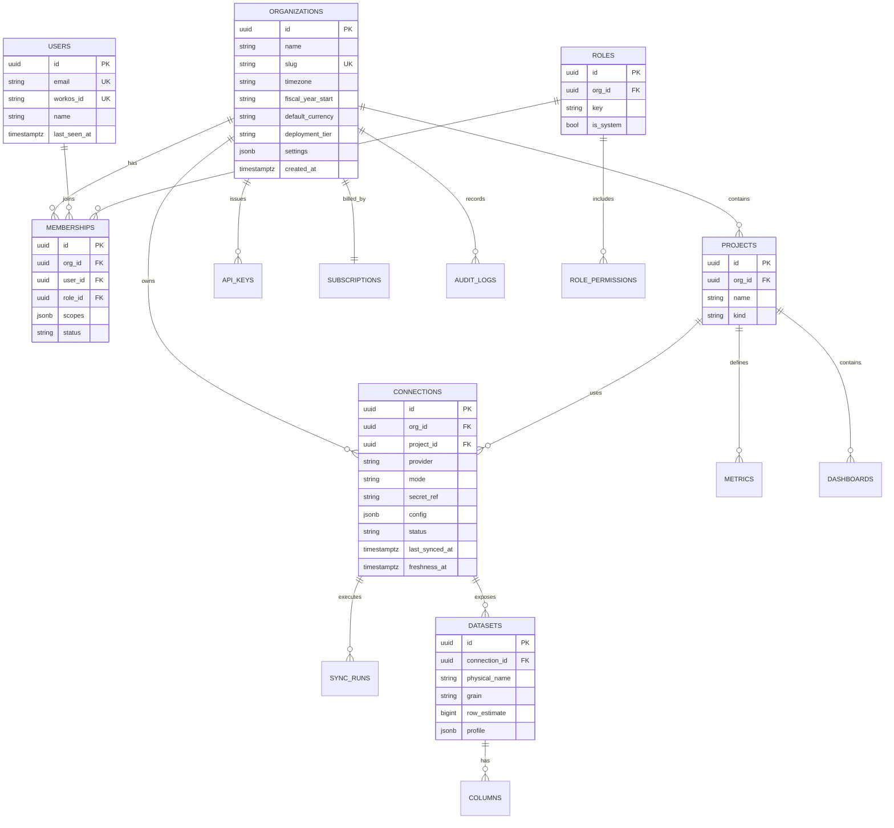

**Design notes.**

`organizations.fiscal_year_start` and `timezone` exist because *every* time-series answer is wrong without them. A "week" for a US retailer starting Sunday and a "week" for a European SaaS starting Monday produce different numbers, and the CFO will notice.

`connections.mode` ∈ `{federated, ingested}` encodes Part 3.4's rule. `freshness_at` is the watermark the agents read to say "data through Aug 5, 09:00 UTC" — showing freshness on every answer is a trust feature, not a nicety.

`connections.secret_ref` is a **pointer into Secrets Manager**, never the credential. This is the difference between a bad breach and a catastrophic one.

`datasets.profile` holds auto-computed column stats (cardinality, null rate, min/max, sample values, inferred semantic type). The semantic layer resolver and the SQL agent both read it — an agent that knows `status` has exactly 6 distinct values writes far better SQL than one that guesses.

## 6.2 Entity map — the semantic layer

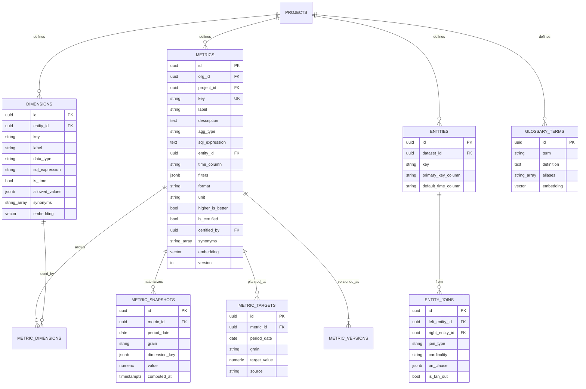

**Design notes.**

`metrics.is_certified` + `certified_by` is the Data Analyst persona's control surface (Part 2.7). Certified metrics rank first in resolution and display a badge; uncertified ones carry a "definition inferred, please confirm" affordance.

`entity_joins.is_fan_out` prevents the most common and most embarrassing class of BI bug: joining orders to line-items and then summing `order_total`, inflating revenue. The compiler refuses to aggregate a metric across a fan-out join without pre-aggregating first (Part 8.5).

`metric_snapshots` is a **materialized daily/weekly cache** of every certified metric across its top dimension combinations, partitioned by month. It exists for three reasons: (1) alerting scans it instead of hammering the customer's warehouse hourly; (2) it is the training data for anomaly baselines; (3) it makes "what changed since yesterday" a single fast local query. This table is one of the highest-leverage things in the design — it converts the product from *reactive* to *proactive* at acceptable cost.

`metric_targets` carries plan/budget/OKR values so variance analysis ("actual vs. plan, and why") works. The Finance persona pays for this.

`metric_versions` (not diagrammed in full) keeps immutable snapshots of definitions so a six-month-old investigation can state "computed under revenue v3."

## 6.3 Entity map — investigations, evidence, memory

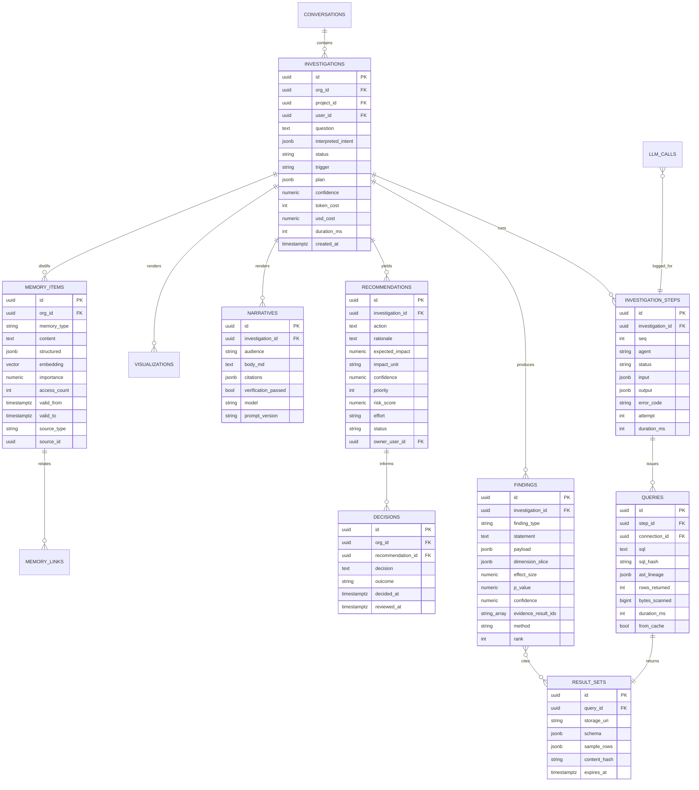

**Design notes — this is the most important diagram in Part 6.**

`findings` is the anti-hallucination substrate. Note the shape: a `statement` in English, a machine-readable `payload`, a `method` naming the statistical test used, `effect_size` and `p_value`, and `evidence_result_ids` pointing to the exact result sets. **The narrative agent is handed findings and nothing else.** `narratives.citations` maps each numeric claim to a `finding_id`; `verification_passed` records whether the numeric-fidelity check succeeded. That boolean is a metric you graph on a dashboard forever.

`queries.ast_lineage` stores tables/columns extracted from the SQLGlot AST. This gives per-answer lineage for free, which the analyst and enterprise personas will ask for in the first meeting.

`result_sets.content_hash` enables cross-investigation dedup and makes the result cache correct rather than hopeful.

`decisions` closes the loop: recommendation → decision → outcome. Once this table has a few hundred rows per org, the system can say "last time we recommended this you did it and it worked." **This is the compounding asset. Nothing else in the schema appreciates like this table does.**

`memory_items.valid_from/valid_to` gives bitemporal memory — "we used to define active user as 7-day, we changed it in March" — which is essential to not confidently applying stale facts.

## 6.4 Entity map — operations

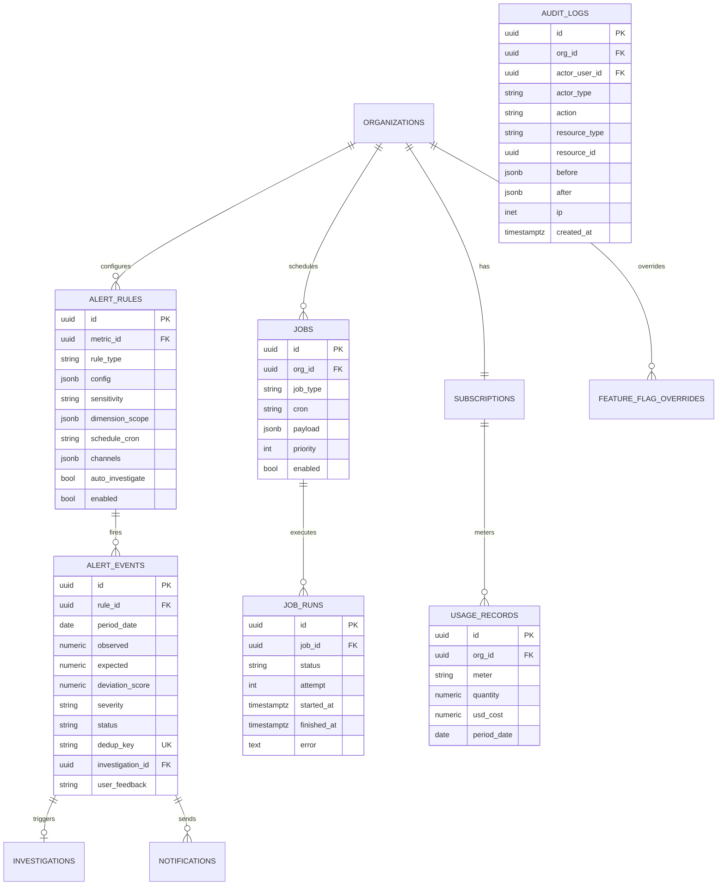

`alert_events.dedup_key` (unique) is the single mechanism that prevents alert fatigue: `hash(rule_id, dimension_slice, anomaly_cluster, period_bucket)`. If it collides, you do not send. Part 16.5 elaborates.

`alert_events.user_feedback` ∈ `{useful, not_useful, already_knew}` is training signal for alert threshold tuning — and it is the metric that tells you whether Stage 5 of the vision ladder is working.

`usage_records` meters LLM tokens and warehouse bytes per org from day one. **You cannot know your gross margin without this, and an AI product with unmetered inference has no business model.** Instrument on day one, not when the bill surprises you.

## 6.5 Representative DDL

```sql
-- Tenancy + RLS pattern applied to every tenant table
CREATE TABLE investigations (
    id                  uuid PRIMARY KEY DEFAULT uuidv7(),
    org_id              uuid NOT NULL REFERENCES organizations(id),
    project_id          uuid NOT NULL REFERENCES projects(id),
    user_id             uuid REFERENCES users(id),
    conversation_id     uuid REFERENCES conversations(id),
    question            text NOT NULL,
    interpreted_intent  jsonb NOT NULL DEFAULT '{}',
    status              text NOT NULL DEFAULT 'planning'
                        CHECK (status IN ('planning','running','complete','failed','partial','cancelled')),
    trigger             text NOT NULL DEFAULT 'user'
                        CHECK (trigger IN ('user','alert','schedule','api','agent')),
    plan                jsonb,
    confidence          numeric(4,3) CHECK (confidence BETWEEN 0 AND 1),
    token_cost          integer NOT NULL DEFAULT 0,
    usd_cost            numeric(10,5) NOT NULL DEFAULT 0,
    duration_ms         integer,
    error_code          text,
    created_at          timestamptz NOT NULL DEFAULT now(),
    updated_at          timestamptz NOT NULL DEFAULT now()
) PARTITION BY RANGE (created_at);

CREATE INDEX ON investigations (org_id, created_at DESC);
CREATE INDEX ON investigations (org_id, status) WHERE status IN ('planning','running');

ALTER TABLE investigations ENABLE ROW LEVEL SECURITY;
CREATE POLICY tenant_isolation ON investigations
    USING (org_id = current_setting('app.current_org_id', true)::uuid);

-- Findings: the evidence substrate
CREATE TABLE findings (
    id                   uuid PRIMARY KEY DEFAULT uuidv7(),
    org_id               uuid NOT NULL,
    investigation_id     uuid NOT NULL REFERENCES investigations(id) ON DELETE CASCADE,
    finding_type         text NOT NULL CHECK (finding_type IN
                           ('trend','anomaly','contribution','correlation','segment',
                            'seasonality','changepoint','comparison','forecast','data_quality')),
    statement            text NOT NULL,
    payload              jsonb NOT NULL,
    dimension_slice      jsonb NOT NULL DEFAULT '{}',
    effect_size          numeric,
    p_value              numeric,
    confidence           numeric(4,3) NOT NULL,
    method               text NOT NULL,          -- e.g. 'stl_robust_zscore_v2'
    evidence_result_ids  uuid[] NOT NULL,
    rank                 integer,
    created_at           timestamptz NOT NULL DEFAULT now(),
    CONSTRAINT findings_need_evidence CHECK (cardinality(evidence_result_ids) > 0)
);
```

That last `CHECK` constraint is small and important: **the database itself refuses to store a finding with no evidence.** Make the invariant unbreakable at the lowest possible layer.

```sql
-- Metric snapshots: partitioned, the engine of proactivity
CREATE TABLE metric_snapshots (
    id             uuid DEFAULT uuidv7(),
    org_id         uuid NOT NULL,
    metric_id      uuid NOT NULL REFERENCES metrics(id),
    period_date    date NOT NULL,
    grain          text NOT NULL CHECK (grain IN ('hour','day','week','month','quarter','year')),
    dimension_key  jsonb NOT NULL DEFAULT '{}',
    dimension_hash text GENERATED ALWAYS AS (md5(dimension_key::text)) STORED,
    value          numeric(24,6),
    computed_at    timestamptz NOT NULL DEFAULT now(),
    PRIMARY KEY (org_id, metric_id, grain, period_date, dimension_hash)
) PARTITION BY RANGE (period_date);

-- Memory with hybrid search
CREATE TABLE memory_items (
    id           uuid PRIMARY KEY DEFAULT uuidv7(),
    org_id       uuid NOT NULL,
    memory_type  text NOT NULL CHECK (memory_type IN
                   ('fact','goal','okr','glossary','investigation_summary','decision',
                    'experiment','correction','preference','event')),
    content      text NOT NULL,
    structured   jsonb NOT NULL DEFAULT '{}',
    embedding    vector(1536),
    importance   numeric(4,3) NOT NULL DEFAULT 0.5,
    access_count integer NOT NULL DEFAULT 0,
    valid_from   timestamptz NOT NULL DEFAULT now(),
    valid_to     timestamptz,
    source_type  text,
    source_id    uuid,
    tsv          tsvector GENERATED ALWAYS AS (to_tsvector('english', content)) STORED
);
CREATE INDEX ON memory_items USING hnsw (embedding vector_cosine_ops);
CREATE INDEX ON memory_items USING gin (tsv);
CREATE INDEX ON memory_items (org_id, memory_type) WHERE valid_to IS NULL;
```

## 6.6 Trade-offs I accepted

| Decision | Cost | Why accepted |
|---|---|---|
| Shared-schema multi-tenancy | Noisy-neighbour risk; RLS adds planner overhead | 100x cheaper to operate; RLS overhead is negligible vs. warehouse query time; `deployment_tier` gives an escape hatch |
| Heavy `jsonb` in agent tables | Weak schema enforcement in DB | Agent output shapes change weekly; Pydantic validates at the boundary; migrating a jsonb column beats migrating 40 columns |
| `metric_snapshots` duplicates warehouse data | Storage, staleness risk | Alerting against a customer's Snowflake hourly is financially and politically unacceptable; snapshots are derived and rebuildable |
| Soft deletes everywhere | Every query needs the predicate | Handled by a SQLAlchemy default query filter; the audit and undo value is worth it |
| Result sets in S3, metadata in PG | Two-system consistency | Row data can be large; keeping it out of Postgres protects the OLTP hot path; TTL cleanup is a cron job |

---

# Part 7 — Connector Framework

## 7.1 The contract

Connectors are the surface area that will consume the most engineering time forever. Get the abstraction right once. Every connector implements one ABC and declares a **capability manifest** — the runtime adapts to the manifest instead of special-casing providers.

```python
# services/connectors/base.py
from typing import Protocol, AsyncIterator
from datetime import datetime
import pyarrow as pa

class Capabilities(BaseModel):
    supports_incremental: bool
    supports_backfill: bool
    supports_pushdown_sql: bool      # True: warehouse. False: SaaS API
    supports_webhooks: bool
    supports_schema_discovery: bool
    max_requests_per_minute: int | None
    cursor_kind: Literal["timestamp", "opaque", "page", "none"]
    min_sync_interval_s: int
    historical_snapshot_required: bool   # CRM objects mutate in place

class Connector(ABC):
    provider: ClassVar[str]
    capabilities: ClassVar[Capabilities]
    config_schema: ClassVar[type[BaseModel]]

    @abstractmethod
    async def test_connection(self) -> HealthReport: ...

    @abstractmethod
    async def discover(self) -> list[StreamSpec]:
        """Return available streams with JSON-schema-typed fields and inferred grain."""

    @abstractmethod
    def read(self, stream: StreamSpec, state: SyncState) -> AsyncIterator[pa.RecordBatch]:
        """Yield Arrow batches. Emit checkpoints via state.checkpoint()."""

    # Provided by the base class, overridable:
    async def execute_sql(self, sql: str, timeout_s: int) -> ResultSet:
        """Only for supports_pushdown_sql connectors."""
        raise NotSupported

    def normalize(self, batch: pa.RecordBatch, stream: StreamSpec) -> pa.RecordBatch:
        """Map provider fields to canonical entities. Default: identity."""
        return batch
```

Two connector *classes* fall out of `supports_pushdown_sql`, and they behave completely differently:

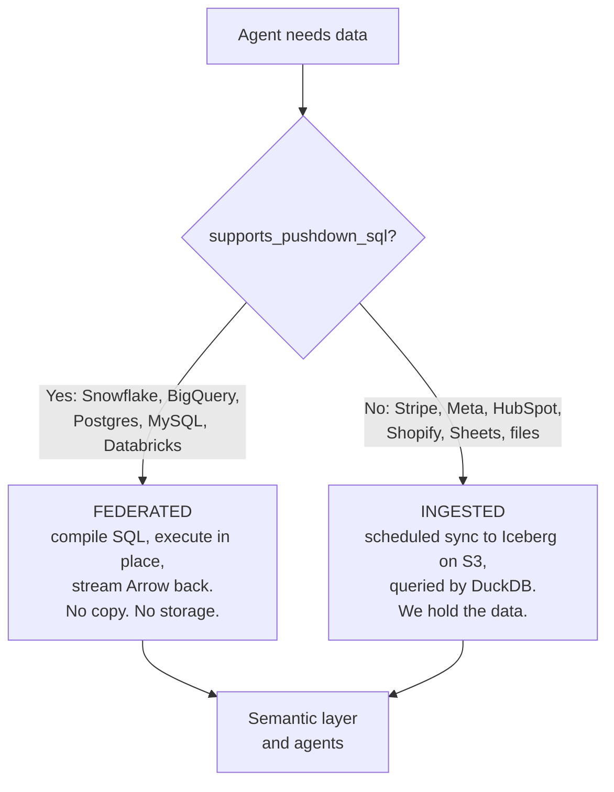

## 7.2 Provider inventory and treatment

| Provider | Class | Auth | Cursor | Notes that will bite you |
|---|---|---|---|---|
| CSV / Excel | Ingested | n/a | none | Type inference is the whole job. Header detection, merged cells, dates as strings. Land in Iceberg, profile aggressively |
| Google Sheets | Ingested | OAuth2 | modifiedTime | Sheets are not tables — ranges shift, users insert columns. Pin by named range; detect schema drift and *ask* rather than guess |
| Postgres / MySQL | Federated | user/pass or IAM, over TLS + SSH tunnel or PrivateLink | n/a | Never query a production OLTP primary without a read replica; enforce `statement_timeout` |
| Snowflake | Federated | key-pair (not password) | n/a | Use a dedicated warehouse + resource monitor. **You can bankrupt a customer with a bad query** — always set `STATEMENT_TIMEOUT_IN_SECONDS` and a byte cap |
| BigQuery | Federated | service account, workload identity | n/a | `maximum_bytes_billed` is mandatory. Dry-run every query first to estimate cost — this is free and prevents disasters |
| Stripe | Ingested | restricted API key (read-only) | `created` + pagination | Rebilling, refunds, disputes and currency conversion make "revenue" genuinely hard. Use Balance Transactions for cash truth, Invoices for accrual |
| Shopify | Ingested | OAuth2 app | `updated_at` | GraphQL bulk operations for backfill; REST is too slow. Cost-based rate limiting via `throttleStatus` |
| Salesforce | Ingested | OAuth2 JWT bearer | `SystemModstamp` | **Historical snapshotting required.** Opportunity stages mutate in place; without daily snapshots you cannot compute stage conversion. Use `OpportunityFieldHistory` where available, plus our own SCD2 |
| HubSpot | Ingested | OAuth2 | `hs_lastmodifieddate` | Same snapshotting issue. Association APIs are separate calls — plan for N+1 |
| Google Ads | Ingested | OAuth2 + developer token | `segments.date` | **Data is retroactively restated for ~7 days** (attribution windows). Always re-sync a trailing window; never trust a closed day |
| Meta Ads | Ingested | OAuth2, long-lived token | `date_start` | Same restatement problem, worse. Async insights jobs for large accounts. Token expiry is a top support ticket — proactive refresh + expiry alerts |
| GA4 | Ingested | OAuth2 / service account | date | Sampling and thresholding silently corrupt small segments. Detect and flag. Prefer BigQuery export when the customer has it |
| Notion / Slack / Zendesk / Jira / Linear / GitHub | Ingested | OAuth2 | varies | These feed **memory and context**, not metrics. A Slack message explaining "we paused the campaign Tuesday" is often the actual root cause. Treat as unstructured context, embed it, and cite it |

**The retroactive-restatement problem deserves emphasis.** Ad platforms revise yesterday's numbers for days. A naive incremental sync locks in wrong data, and then your anomaly detector fires on your own sync bug. Every ingested connector declares a `restatement_window_days`, and the sync engine always re-reads that window. Getting this wrong produces the most damaging failure mode this product has: **confidently explaining a change that never happened.**

## 7.3 Sync engine

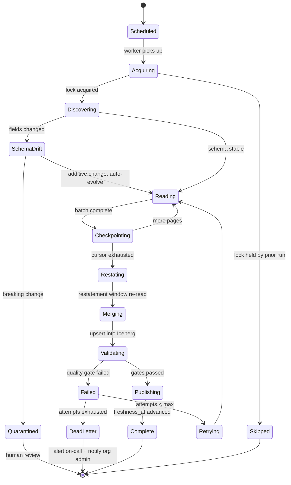

**Incremental sync.** State is `{stream, cursor_value, cursor_kind, last_success_at, restatement_from}` persisted per stream, checkpointed *per batch* rather than per run — a sync that dies at 90% resumes at 90%. Merge into Iceberg is an idempotent `MERGE` on the stream's primary key, so replays are safe. Where the provider has no reliable cursor, fall back to full refresh with content hashing to avoid rewriting unchanged partitions.

**Slowly-changing dimensions.** For `historical_snapshot_required` streams (Salesforce, HubSpot), we write SCD Type 2: `valid_from`, `valid_to`, `is_current`. This is the only way to answer "what did the pipeline look like on July 1" — a question sales leaders ask constantly and most tools answer wrongly.

**Rate limiting.** A shared token bucket in Redis, keyed `(provider, org, account)` — sharing must be per customer-account, not global, or one large customer starves everyone. The limiter is **adaptive**: it reads `Retry-After` and `X-RateLimit-Remaining` and lowers its own ceiling, rather than assuming documented limits are real (they usually are not). AIMD: additive increase on success, multiplicative decrease on 429.

**Retries.** Classify before retrying — this table is the difference between a robust connector and a support burden:

| Error class | Examples | Policy |
|---|---|---|
| Transient | 5xx, timeout, connection reset | Exponential backoff + jitter, 5 attempts |
| Rate limited | 429 | Honour `Retry-After`; lower bucket; not counted against attempts |
| Auth expired | 401 | Attempt refresh once; on failure → `needs_reauth`, notify org admin, **stop** |
| Auth revoked | 403 | No retry. Disable connection, notify |
| Schema breaking | Column removed/retyped | Quarantine stream, keep others running, notify |
| Data quality | Freshness/volume/null gate failed | Do not publish; keep last good watermark; alert |
| Permanent | 404, malformed | Skip record, log, continue; alert if >1% of batch |

The principle: **a failing connector must never silently serve stale data as fresh.** `freshness_at` only advances on a successful, validated publish, and every answer the agents produce carries the freshness of its inputs. An agent that notices `freshness_at` is 3 days old says so in the answer.

**Scheduling.** Cron per connection with jitter to avoid thundering herds; priority queue so an interactive backfill outranks a routine nightly sync; a per-org concurrency cap so one customer's 40 connections cannot saturate the worker pool.

## 7.4 Auth handling

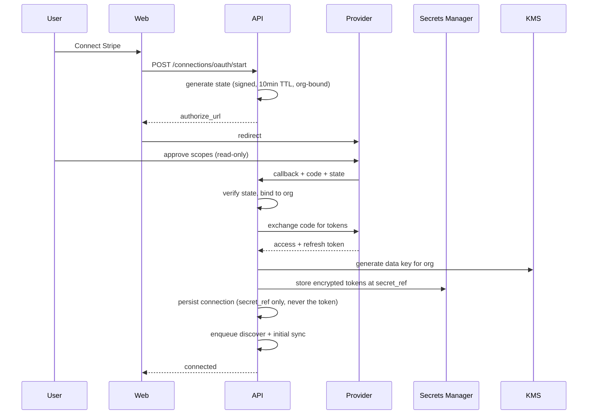

Rules that are non-negotiable: request **read-only scopes only** (it makes security review trivial and limits blast radius); refresh proactively at 75% of token lifetime rather than reactively on 401; envelope-encrypt with a per-org KMS data key so a Secrets Manager compromise still requires KMS access; and store nothing but `secret_ref` in Postgres.

## 7.5 Building a new connector

The measure of this framework is time-to-new-connector. Target: **under one day for a well-documented REST API.** A generated scaffold gives you `manifest.yaml` (capabilities, streams, rate limits, restatement window), `client.py` (thin API wrapper), `streams.py` (per-stream read logic), `normalize.py` (map to canonical entities), `metrics.yaml` (starter metric definitions so the connector is useful the moment it syncs), and `tests/` with recorded HTTP cassettes.

That `metrics.yaml` is the trick most integration frameworks miss: **a connector that delivers raw tables is 20% of the value; a connector that delivers raw tables plus twelve correctly-defined metrics is 100% of it.** Shipping `stripe/metrics.yaml` with MRR, ARR, churn, ARPU, LTV and net revenue retention already defined is what makes onboarding feel magical instead of like homework.

---

# Part 8 — Semantic Layer

## 8.1 Why this exists, stated bluntly

Text-to-SQL against a raw schema is a demo, not a product. Published benchmarks put naive text-to-SQL execution accuracy on realistic enterprise schemas in the 40–70% range. **A business intelligence product with 70% accuracy is worth less than zero**, because a confident wrong number is more expensive than no number.

The semantic layer moves the hard problem from *"generate correct SQL over 400 unfamiliar tables"* to *"pick the right metric from a curated list of 60."* The second problem is tractable at high accuracy; the first is not.

It also does something a chatbot fundamentally cannot: it encodes **the company's** definition of revenue — which excludes test accounts, nets refunds, uses booking date not payment date, and converts currency at the month-end rate. There is no universal definition of revenue. There is only *this company's*, and it lives here.

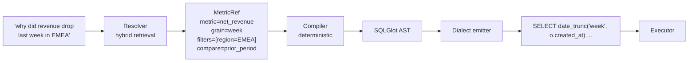

The critical structural point: **the LLM's output is a `MetricRef`, not SQL.** A `MetricRef` is a small, validated, closed-vocabulary object. If the model hallucinates a metric name, validation fails loudly and we ask a clarifying question. If the model hallucinated SQL, it would fail *silently* and return a wrong number. This is the difference between a system that is wrong 5% of the time and *knows it*, and one that is wrong 30% of the time and doesn't.

## 8.2 The definition language

Metrics are YAML in the repo (or the customer's git), loaded into the `metrics` table, versioned. Analysts can edit YAML or use the UI; both write the same objects.

```yaml
# configs/metrics/ecommerce.yaml
version: 1

entities:
  - key: orders
    dataset: analytics.fct_orders
    primary_key: order_id
    default_time_column: ordered_at
    dimensions:
      - key: channel
        sql: "{{entity}}.acquisition_channel"
        synonyms: [source, traffic source, acquisition channel]
      - key: region
        sql: "{{entity}}.billing_country_region"
        synonyms: [geo, market, territory]
      - key: is_first_order
        sql: "{{entity}}.order_sequence = 1"
        data_type: boolean

  - key: customers
    dataset: analytics.dim_customers
    primary_key: customer_id
    dimensions:
      - key: segment
        synonyms: [customer tier, plan]

joins:
  - left: orders
    right: customers
    type: many_to_one          # safe to aggregate across
    on: "orders.customer_id = customers.customer_id"

metrics:
  - key: gross_revenue
    label: Gross Revenue
    description: >
      Total order value before refunds and discounts. Excludes internal
      test accounts and cancelled orders. Recognized on order date.
    entity: orders
    agg: sum
    sql: "{{entity}}.order_total"
    filters:
      - "{{entity}}.status NOT IN ('cancelled','test')"
      - "{{entity}}.customer_id NOT IN (SELECT customer_id FROM analytics.internal_accounts)"
    time_column: ordered_at
    format: currency
    unit: USD
    higher_is_better: true
    synonyms: [revenue, sales, top line, gross sales, GMV]
    certified: true
    owner: finance@acme.com

  - key: net_revenue
    label: Net Revenue
    description: Gross revenue less refunds, discounts and chargebacks.
    type: derived
    expression: "gross_revenue - refunds - discounts"
    format: currency
    synonyms: [net sales, revenue net of refunds]
    certified: true

  - key: aov
    label: Average Order Value
    type: ratio
    numerator: net_revenue
    denominator: order_count
    format: currency
    # ratios must never be averaged across groups — the compiler enforces
    # re-computation from components at every grain

  - key: cac
    label: Customer Acquisition Cost
    type: ratio
    numerator: marketing_spend       # different entity!
    denominator: new_customers
    format: currency
    higher_is_better: false
    synonyms: [acquisition cost, cost per customer, CAC]
    # cross-entity ratio: compiler produces two aggregates and joins on the
    # shared time grain + shared dimensions only

time_intelligence:
  fiscal_year_start: "01-01"
  week_starts_on: monday
  default_comparisons: [prior_period, prior_year, plan]
```

## 8.3 What the compiler guarantees

The compiler is ~2000 lines of deterministic Python over SQLGlot. It guarantees, by construction:

1. **Filters are never lost.** Metric-level filters (test accounts, cancelled orders) are injected into every query. This is the #1 source of wrong numbers in hand-written SQL and it is impossible here.
2. **Ratios are recomputed, never averaged.** `AVG(aov)` across regions is wrong; `SUM(net_revenue)/SUM(order_count)` is right. The compiler expands ratio metrics at every requested grain. Simpson's paradox is a *default-off* behaviour, not a footgun.
3. **Fan-out joins cannot inflate additive metrics.** If a requested dimension requires a one-to-many join, the compiler pre-aggregates the metric at its native grain in a CTE, then joins. Without this, adding a "product category" breakdown silently triples revenue.
4. **Time is handled correctly.** Fiscal calendars, week start, timezone conversion from UTC storage to org timezone, and correct partial-period handling — a "this month" comparison must compare month-to-date against month-to-date, not against a full prior month. This mistake alone generates a huge share of false panic.
5. **Every query is bounded.** `LIMIT`, statement timeout, and byte cap injected at the AST level.
6. **Dialect correctness.** One logical plan, ten dialects, via SQLGlot's transpiler.

## 8.4 Time intelligence

| Concept | Handling |
|---|---|
| Grain | hour · day · week · month · quarter · year, honouring org week-start and fiscal year |
| Period-over-period | `prior_period`, `prior_year`, `prior_quarter`, aligned by *position in period*, not raw date offset (so week-over-week compares Monday to Monday) |
| Partial periods | MTD vs. MTD, WTD vs. WTD. Always. A full-vs-partial comparison is treated as a bug |
| Rolling windows | 7/28/90-day rolling sums and averages; 28 rather than 30 because it holds day-of-week composition constant, which materially reduces false anomalies |
| Trailing twelve months | For seasonal businesses and any annualized metric |
| Timezone | Stored UTC, converted at query time to org timezone. Cross-timezone customers get a per-project override |
| Lag/lead | Native to the compiler so contribution analysis doesn't hand-roll window functions |

## 8.5 Natural language → metric resolution

This is the accuracy-critical path. It is a **retrieval problem, not a generation problem** — which is the key insight, because retrieval can be measured, tuned, and made to fail loudly.

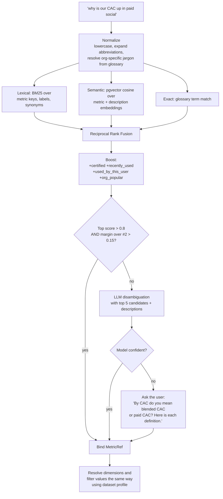

**Design commitments in this flow:**

- **Asking is a feature, not a failure.** A senior analyst asks "do you mean blended or paid CAC?" A junior one guesses. Guessing is how you lose the account. Clarification is cheap; a wrong board number is not.
- **Filter values resolve against the profiled column values**, not the model's imagination. "paid social" must map to an actual value in `channel` — we do fuzzy + embedding matching against the real distinct values captured in `datasets.profile`. If nothing matches above threshold, we say "I don't see a channel called 'paid social'; I see 'Facebook Ads', 'Instagram', 'TikTok' — did you mean these three?"
- **Every resolution is logged with its score.** Resolution accuracy on a golden set is your single most important product metric. Graph it. Gate deploys on it.
- **User corrections write back.** When a user picks a different metric than we proposed, that becomes a synonym candidate and a memory item (Part 11.6). The system's accuracy compounds per customer, which is precisely the switching cost you want.

## 8.6 Importing existing models

Never ask a customer to redefine what they already defined. Adapters read:

| Source | What we extract | Notes |
|---|---|---|
| **dbt** | `manifest.json` → models, columns, descriptions, tests, semantic models & metrics | Highest-value importer. dbt tests tell us which columns are trustworthy — free data-quality signal |
| **LookML** | Explores, views, dimensions, measures, joins | Directly maps to our entity/dimension/metric model. Unlocks Looker accounts |
| **Cube** | Cubes, measures, dimensions, pre-aggregations | Nearly 1:1 |
| **Power BI** | Dataset DAX measures | Partial — DAX is a translation problem; import descriptions and names, ask for confirmation on logic |

## 8.7 Cold start — the onboarding problem

Most customers have no semantic layer. Time-to-first-correct-answer must be under 15 minutes or activation collapses.

1. **Profile.** Enumerate tables, row counts, column cardinality, null rates, min/max, sample values, inferred semantic types (this looks like an email, that's a currency amount, that's a foreign key).
2. **Infer relationships.** Name and value-overlap heuristics propose joins with confidence. Confirm the top ones with the user; do not silently assume.
3. **Propose metrics.** An LLM proposes 15–40 metrics from the profile *plus* an industry metric pack matched to the detected connectors (Stripe present → propose MRR, churn, ARPU; Shopify → AOV, repeat rate, contribution margin).
4. **Confirm interactively.** Show each proposed metric with its SQL, its value for last month, and a sparkline. **A number the founder recognizes is the fastest possible trust signal** — "yes, that's our revenue" takes two seconds to verify and converts the whole onboarding.
5. **Learn continuously.** Every asked question and every correction refines synonyms, and unresolvable questions surface as "metrics your team asked for but you haven't defined" — which is both a great product surface and a great expansion hook.

---

# Part 9 — AI Pipeline

## 9.1 Full pipeline

```mermaid
flowchart TD
    Q["QUESTION<br/>user, alert, schedule or API"] --> G["GUARD<br/>PII scan, injection check,<br/>budget + quota check"]
    G --> MEM["MEMORY RETRIEVAL<br/>glossary, OKRs, prior investigations,<br/>corrections, recent KPI state"]
    MEM --> PLAN["PLANNER<br/>question + memory + catalog<br/>-> Plan DAG"]
    PLAN --> INT["INTENT DETECTION<br/>lookup | comparison | diagnostic |<br/>forecast | recommendation | exploratory"]
    INT --> MET["METRIC EXTRACTION<br/>-> MetricRef via semantic resolver"]
    MET --> AMB{"Ambiguous or<br/>undefined?"}
    AMB -->|yes| CLAR["CLARIFY<br/>ask user, then resume"]
    AMB -->|no| CONN["CONNECTOR SELECTION<br/>choose source, check freshness,<br/>decide federated vs local"]
    CLAR --> CONN
    CONN --> QP["QUERY PLANNING<br/>decompose into N queries;<br/>identify parallelizable set"]
    QP --> SQL["SQL GENERATION<br/>semantic compiler first;<br/>LLM escape hatch only if uncoverable"]
    SQL --> VAL["VALIDATION<br/>AST: read-only, tenant filter, limits,<br/>cost estimate, dry run"]
    VAL --> FAIL{"Valid?"}
    FAIL -->|no| REPAIR["REPAIR LOOP<br/>error + schema back to agent,<br/>max 2 attempts"]
    REPAIR --> VAL
    FAIL -->|yes| EXEC["EXECUTION<br/>parallel, cached, timeout-bounded<br/>-> ResultSets"]
    EXEC --> DQ["DATA QUALITY GATE<br/>freshness, volume, null spike,<br/>partial-period detection"]
    DQ --> EV["EVIDENCE GENERATION<br/>deterministic statistics<br/>-> Findings"]
    EV --> RANK["EVIDENCE RANKING<br/>effect size x significance x<br/>novelty x business relevance"]
    RANK --> REASON["REASONING<br/>hypothesis generation<br/>+ falsification loop"]
    REASON --> MORE{"Need more<br/>evidence?"}
    MORE -->|yes| QP
    MORE -->|no| RCA["ROOT CAUSE<br/>causal chain assembly<br/>+ confidence scoring"]
    RCA --> REC["RECOMMENDATION<br/>rules + LLM, constrained<br/>by business rules"]
    REC --> NARR["NARRATIVE GENERATION<br/>findings-only context,<br/>audience-tuned"]
    NARR --> VER["VERIFY<br/>every number traces to a finding"]
    VER --> VFAIL{"Passed?"}
    VFAIL -->|no, retry < 2| NARR
    VFAIL -->|no, exhausted| DEGRADE["DEGRADE<br/>evidence cards, no prose"]
    VFAIL -->|yes| VIZ["VISUALIZATION<br/>chart selection -> Vega-Lite spec<br/>-> schema validation"]
    VIZ --> RESP["RESPONSE<br/>stream narrative + charts +<br/>trace + confidence"]
    DEGRADE --> RESP
    RESP --> LEARN["PERSIST TO MEMORY<br/>summary, findings, corrections"]
```

## 9.2 Stage by stage

**1 · Guard.** Before a token is spent: scan the question for PII we should redact from logs; detect prompt-injection patterns (especially important because questions can arrive from Slack messages and connector data); check the org's quota and the run's cost budget. Cheap, and it prevents a class of incidents.

**2 · Memory retrieval.** *Before* planning, not after. The planner's quality depends almost entirely on context. Retrieve: glossary terms matching question tokens, active OKRs and targets for candidate metrics, the 3 most similar prior investigations, any user corrections relevant to these metrics, and the current KPI state snapshot. Budgeted at ~2000 tokens; retrieval is described in Part 11.4.

**3 · Planner.** Produces a typed `Plan`: a DAG of steps, each naming an agent, its inputs, its dependencies, and a cost/time budget. Planning explicitly rather than letting an agent free-run gives you three things: parallelism (independent steps run concurrently), predictable cost (budget known before spend), and streaming UX (the user sees the plan immediately, which makes a 30-second wait feel intentional rather than broken).

**4 · Intent detection.** Part of planning, but called out because it selects the whole downstream shape:

| Intent | Example | Pipeline shape | Latency target |
|---|---|---|---|
| `lookup` | "What was revenue last month?" | Metric → SQL → execute → format. Skip evidence engine entirely | < 3s |
| `comparison` | "Revenue this month vs. last" | Lookup × 2 + delta + significance | < 5s |
| `diagnostic` | "Why did revenue drop?" | **Full pipeline.** The flagship path | < 45s |
| `forecast` | "Will we hit plan?" | History → model selection → forecast → interval | < 20s |
| `recommendation` | "What should we do about CAC?" | Diagnostic → recommendation engine | < 60s |
| `exploratory` | "Anything I should know?" | Scan snapshots → rank anomalies → mini-diagnostics on top 3 | < 90s, async |
| `definitional` | "How do we define CAC?" | Semantic layer + glossary. No query at all | < 1s |

Routing correctly is a large cost and latency win: roughly 60% of questions are `lookup` or `definitional` and must never touch the expensive path. Route these to a small fast model.

**5 · Metric extraction.** Part 8.5.

**6 · Connector selection.** Which connection serves this metric? Is it fresh enough for the question ("today" needs today's data; "last quarter" does not)? Federated or local? If freshness is insufficient, either trigger a sync and wait, or answer with an explicit staleness caveat — never silently.

**7 · Query planning.** A diagnostic decomposes into a *set* of queries: the metric trend, the same metric split by each of the top-K candidate dimensions, related metrics on the same time axis, and comparison periods. The planner marks the independent ones for parallel execution. Typical diagnostic: 8–20 queries, 3–5 waves.

**8 · SQL generation.** Semantic compiler first; it covers ~85% of questions deterministically. The LLM SQL agent is the **escape hatch** for genuinely uncovered questions and always operates with the profiled schema, sample rows, and known join graph in context. Crucially, LLM-generated SQL is marked `provenance='llm'` and its results are held to a higher validation bar and shown with a "custom query" badge in the trace.

**9 · Validation.** The security-critical stage. Parse to AST with SQLGlot and assert: single statement; `SELECT`/`WITH` only; no DDL/DML/`COPY`/`GRANT`; every referenced table is in the allowlist for this connection; tenant filter present where required; `LIMIT` injected; estimated cost within budget (BigQuery dry run, Snowflake `EXPLAIN`). AST-level, not regex — regex validation of SQL is security theatre.

**10 · Repair loop.** On execution or validation error, hand the agent the exact error, the relevant schema, and the failed SQL. Two attempts, then fail that step and continue the investigation without it. Bounded loops always; an unbounded self-correcting agent is a cost incident.

**11 · Execution.** Parallel with a per-org concurrency cap, per-query timeout, result cache keyed on `(connection, sql_hash, freshness_bucket)`. Results land in S3 as Arrow, with metadata and a content hash in Postgres.

**12 · Data quality gate.** Before any inference: is the latest period complete, or are we comparing a partial week to a full one? Did row volume drop >50% (usually a broken sync, not a business event)? Did a null rate spike? **A large share of apparent business anomalies are data pipeline problems, and an analyst who mistakes one for the other loses all credibility.** When this gate fires, the answer leads with the data issue rather than inventing a business explanation.

**13 · Evidence generation.** Deterministic statistics only. Part 12.

**14 · Evidence ranking.** `score = f(effect_size, statistical_significance, novelty_vs_history, business_relevance, recency)`. Novelty matters more than people expect: "EMEA is 30% of revenue" is true, statistically strong, and useless. "EMEA dropped 18% when it normally varies 3%" is the finding.

**15 · Reasoning with falsification.** The differentiating stage. The agent generates hypotheses from the ranked findings, then — for each — **states what evidence would disconfirm it and requests that query.** If revenue dropped and paid search spend fell, the hypothesis "spend cut caused the drop" predicts that organic revenue held steady. Test it. A hypothesis that survives a disconfirmation attempt gets high confidence; one that fails is discarded, not softened. This loop is why the product beats a chatbot: chatbots generate the first plausible story and stop.

**16 · Root cause assembly.** Findings → causal chain with confidence. Part 12.

**17 · Recommendation.** Part 13.

**18 · Narrative generation.** The narrative agent receives **findings and memory only — it has no access to raw result sets**, enforced at the tool level, not by prompt instruction. Prompt-level restrictions are suggestions; tool-level restrictions are guarantees. Audience-tuned: executive (3 sentences, headline number, one action), analyst (methods, caveats, confidence), operational (specific slices and owners).

**19 · Verification.** Extract every numeric token from the narrative; assert each appears in a cited finding within rounding tolerance; assert every causal claim maps to a finding with confidence above threshold; assert hedging language matches actual confidence (no "clearly caused by" on a 0.4-confidence finding). Fail → regenerate → fail again → degrade to evidence cards.

**20 · Visualization.** Part 15.

**21 · Response.** Streamed throughout — the user sees the plan at t≈1s, evidence cards as they land, narrative last. Perceived latency is dominated by time-to-first-token, not total time.

**22 · Memory persistence.** Summarize the investigation, extract durable facts, store the conclusion, link to prior related investigations. Part 11.

## 9.3 Cost and latency budget for a diagnostic

| Stage | Model | Tokens | Latency | Cost |
|---|---|---|---|---|
| Guard | none / classifier | — | 50ms | ~0 |
| Memory retrieval | embedding + PG | 2k in | 200ms | $0.0001 |
| Planner | frontier | 4k in / 1k out | 3s | $0.03 |
| Metric resolution | embedding + small | 1k | 300ms | $0.0005 |
| SQL generation ×3 | mid-tier | 3k in / 500 out | 2s (parallel) | $0.01 |
| Execution ×12 | — | — | 8s (parallel) | warehouse cost |
| Evidence engine | **none — pure code** | — | 2s | ~0 |
| Reasoning + falsification | frontier | 8k in / 2k out | 6s | $0.06 |
| Recommendation | frontier | 4k in / 1k out | 3s | $0.03 |
| Narrative | frontier | 5k in / 1k out | 4s | $0.035 |
| Verification | code + small model | 2k | 500ms | $0.002 |
| Visualization | mid-tier | 2k in / 800 out | 1.5s | $0.005 |
| **Total** | | ~35k | **~30s** | **~$0.17** |

At $0.17 per diagnostic and, say, 400 diagnostics/month for a $500/month account, LLM COGS is ~$68 — a 86% gross margin before warehouse costs. That is a viable business, **but only because the evidence engine is free.** If you replaced the statistics with an LLM reading raw rows, cost would rise roughly 10x and accuracy would fall. This table is the economic argument for the entire architecture.

**Model routing policy:** frontier models for planning, reasoning, and narrative (judgement-heavy, low volume); mid-tier for SQL and visualization (structured, verifiable); small/fast for classification, routing, and verification (high volume, simple). Never use one model for everything — it is either too expensive or too weak, depending on which one you pick.

## 9.4 API surface

```http
POST /v1/investigations
Authorization: Bearer sk_live_...
Idempotency-Key: 7c1f...

{
  "question": "Why did revenue drop last week?",
  "project_id": "proj_01J...",
  "audience": "executive",
  "stream": true,
  "max_cost_usd": 0.50,
  "context": { "focus_dimensions": ["channel", "region"] }
}
```

```
HTTP/1.1 200 OK
Content-Type: text/event-stream

event: investigation.created
data: {"id":"inv_01J8...","status":"planning"}

event: plan.ready
data: {"steps":[{"seq":1,"agent":"sql","label":"Revenue trend, 12 weeks"},
                {"seq":2,"agent":"root_cause","label":"Decompose by 6 dimensions"}],
        "estimated_seconds":28,"estimated_cost_usd":0.17}

event: finding.created
data: {"id":"fnd_01J...","type":"anomaly","statement":"Net revenue fell 12.4% WoW to $418,203",
       "confidence":0.97,"method":"stl_robust_zscore_v2","effect_size":-0.124,
       "evidence_result_ids":["rs_01J..."]}

event: finding.created
data: {"id":"fnd_02K...","type":"contribution",
       "statement":"Paid Search in EMEA contributed -8.1pp of the -12.4pp move",
       "dimension_slice":{"channel":"Paid Search","region":"EMEA"},
       "confidence":0.91,"method":"mix_shift_decomposition_v1"}

event: narrative.delta
data: {"text":"Revenue fell 12.4% last week, driven almost entirely by "}

event: investigation.completed
data: {"id":"inv_01J8...","confidence":0.88,"duration_ms":29140,
       "usd_cost":0.163,"verification_passed":true}
```

```http
GET /v1/investigations/inv_01J8.../trace
```
Returns the full audit object: plan, every step, every SQL statement with its lineage, row counts, bytes scanned, every finding with its method and statistics, the prompt versions used, and the verification result. **This endpoint is the trust product.** Build it early; it is what wins the analyst's approval and passes enterprise review.

Other core routes: `POST /v1/metrics` (define), `POST /v1/metrics/resolve` (debug NL→metric, invaluable), `POST /v1/connections`, `POST /v1/alerts/rules`, `GET /v1/memory/search`, `POST /v1/reports/generate`.

---

# Part 10 — Agents

## 10.1 Agent design rules

Before the individual specs, five rules that apply to all of them. These exist because multi-agent systems fail in predictable ways.

1. **Agents are functions with tools, not autonomous entities.** Typed input, typed output, bounded steps, bounded cost. An agent that can loop forever is an outage waiting to be discovered on your credit card statement.
2. **Tool access is the real permission system.** The Narrative Agent cannot see raw data because it has no tool that returns raw data. Do not rely on prompt instructions for anything that matters — a prompt is a suggestion, a missing tool is a guarantee.
3. **Every agent degrades rather than raises.** Failure returns a partial result plus an explicit gap marker. The orchestrator decides whether the investigation can proceed. Ten agents where any failure kills the run gives you a system that never completes.
4. **Every agent emits a trace span** with prompt version, model, tokens, cost, latency, and structured output. Non-negotiable for debugging and COGS.
5. **Statistics belong in code, not agents.** If a task has a correct answer computable deterministically, an agent must not do it. Agents choose *which* analysis to run; code runs it.

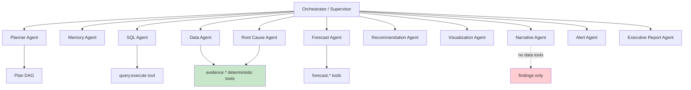

## 10.2 Agent specifications

### Planner Agent
- **Responsibility.** Convert a question + memory + semantic catalog into a typed `Plan` DAG. Classify intent, choose the pipeline shape, allocate budget, mark parallelizable steps.
- **Inputs.** Question, memory bundle, metric catalog summary, connection health/freshness, remaining org quota.
- **Outputs.** `Plan{intent, steps[], estimated_cost, estimated_duration, clarification_needed?}`
- **Tools.** `semantic.search_metrics`, `memory.retrieve`, `connections.get_health`.
- **Memory.** Reads episodic (similar prior questions and the plans that worked) — this makes the planner improve per-org over time.
- **Failure.** Cannot classify → fall back to a conservative default plan for `diagnostic`. Cannot find metrics → emit `clarification_needed` instead of guessing. **The planner must never fabricate a metric key**; output is validated against the catalog and rejected if unknown.
- **Model.** Frontier. This is the highest-leverage inference in the system; a bad plan wastes everything downstream.

### SQL Agent
- **Responsibility.** Produce validated SQL for steps the semantic compiler cannot cover. Repair failing SQL.
- **Inputs.** Step spec, profiled schema (tables, columns, types, cardinalities, sample values), join graph, dialect, prior error if repairing.
- **Outputs.** `{sql, ast_lineage, estimated_cost, confidence}`
- **Tools.** `schema.describe`, `schema.sample_values`, `sql.validate` (AST checks, no execution), `sql.dry_run` (cost estimate).
- **Memory.** Reads the org's previously successful SQL patterns for similar questions — a genuinely effective few-shot source.
- **Failure.** Two repair attempts, then abandon the step. Never executes unvalidated SQL — the tool boundary makes this structural: the agent has no execute tool at all, only the orchestrator does.
- **Model.** Mid-tier. Output is machine-verified, so spending frontier tokens here is waste.

### Data Agent
- **Responsibility.** Guard the integrity of every result set before it becomes evidence. Freshness, completeness, partial-period detection, volume shifts, null spikes, schema drift, duplicate detection.
- **Inputs.** ResultSets + connection metadata + historical volume baselines.
- **Outputs.** `DataQualityReport{issues[], severity, blocks_analysis: bool}`
- **Tools.** `evidence.volume_check`, `evidence.freshness_check`, `evidence.completeness_check` — all deterministic.
- **Failure.** Fail *loud*. If quality blocks analysis, the investigation returns "your Shopify sync last succeeded 3 days ago, so I can't answer this reliably" rather than a confident wrong answer.
- **Model.** Mostly none — this agent is 90% code, with a small model only to phrase the issue.
- **Why it exists as a distinct agent:** in production, my estimate is that **20–30% of "why did X change" questions have a data pipeline answer, not a business answer.** Catching those is a credibility multiplier.

### Root Cause Agent
- **Responsibility.** Orchestrate the evidence engine, generate hypotheses, run falsification, assemble a causal chain with confidence.
- **Inputs.** Anomaly finding, metric definition, available dimensions, memory (prior causes for this metric, known business events).
- **Outputs.** `CausalChain{hypotheses[], surviving[], rejected[], primary_cause, contributing[], unexplained_share, confidence}`
- **Tools.** `evidence.decompose`, `evidence.correlate`, `evidence.seasonality`, `evidence.changepoint`, `evidence.segment_scan`, `query.request` (asks orchestrator for a new query — cannot execute directly), `memory.retrieve_events`.
- **Memory.** Heavy read. "Last March this same drop was caused by the annual renewal cycle" is exactly the context that separates us from a stranger looking at a chart.
- **Failure.** If no hypothesis survives falsification, **say so.** `"Revenue fell 12%. I decomposed across 8 dimensions and the decline is broadly distributed — no single driver explains more than 2pp. This pattern is consistent with a demand-side or seasonal effect rather than a specific channel failure."` Reporting an honest null result is a feature; inventing a cause is the cardinal sin.
- **Key output field: `unexplained_share`.** Always report how much of the movement remains unexplained. Analysts trust a system that admits residuals.
- **Model.** Frontier.

### Forecast Agent
- **Responsibility.** Select an appropriate model, produce forecasts with prediction intervals, backtest, explain drivers.
- **Inputs.** Historical series, exogenous regressors, targets/plan, horizon.
- **Outputs.** `Forecast{point[], lower[], upper[], model, backtest_mape, drivers[], caveats[]}`
- **Tools.** `forecast.fit`, `forecast.backtest`, `forecast.select_model`, `forecast.scenario`.
- **Failure.** Insufficient history (<2 seasonal cycles) → return a naive/drift baseline with an explicit warning, never a sophisticated model on thin data. Backtest MAPE worse than naive → return the naive forecast and say so.
- **Rule.** **Never present a point forecast without an interval.** A single number implies a precision that does not exist and will be quoted back to you in a board meeting.

### Recommendation Agent
- **Responsibility.** Turn causal findings into ranked, constrained, quantified actions.
- **Inputs.** CausalChain, forecast, business constraints (budget caps, policy, brand rules from memory), historical decisions and their outcomes, org context.
- **Outputs.** `Recommendation[]{action, rationale, expected_impact, impact_unit, confidence, risk_score, effort, priority, evidence_ids, reversible: bool}`
- **Tools.** `rules.evaluate`, `memory.retrieve_decisions`, `forecast.scenario`, `impact.estimate`.
- **Failure.** Confidence below threshold → return diagnostic questions instead of actions. "I don't have enough evidence to recommend a spend change; here are the three things I'd check first" is a legitimate and often correct output.
- **Constraint.** Every recommendation must cite the findings supporting it and state expected impact with a range. An action without a quantified expected impact is an opinion.

### Visualization Agent
- **Responsibility.** Choose the chart type and emit a validated Vega-Lite spec.
- **Inputs.** ResultSet schema + finding type + audience + column semantics.
- **Outputs.** `VegaLiteSpec` (schema-validated before it ever reaches the browser).
- **Failure.** Invalid spec → fall back to the deterministic rule-based selector (Part 15.2), then to a table. Never render unvalidated agent output.
- **Model.** Mid-tier, or often none — the rule engine handles most cases correctly and instantly.

### Memory Agent
- **Responsibility.** Both directions. Retrieve relevant context before a run; distill and write durable memory after.
- **Inputs (write).** Completed investigation, findings, user reactions, corrections.
- **Outputs (write).** `MemoryItem[]` with type, importance, validity window, entity links.
- **Tools.** `memory.search` (hybrid), `memory.write`, `memory.link`, `memory.supersede`, `memory.decay`.
- **Failure.** Retrieval failure degrades to no-memory operation — the investigation still runs, just without history. Write failure is retried async and never blocks a response.
- **Critical behaviour: supersession.** When a new fact contradicts an old one, the old item gets `valid_to` set rather than being deleted. History of belief matters; deleting it makes the system unable to explain why it used to say something different.

### Executive Report Agent
- **Responsibility.** Compose multi-investigation narratives — daily digest, weekly business review, monthly board pack.
- **Inputs.** Metric snapshot deltas, all findings/alerts in period, OKR progress, prior period's report, audience.
- **Outputs.** Structured report → HTML email, PDF, PPTX.
- **Failure.** No significant findings → send a short "all metrics within normal range" note. **Do not manufacture content to fill a template.** A digest that cries wolf every day gets filtered to spam in a week.
- **Note.** This agent is a major retention driver. Answering questions is on-demand and forgettable; a daily digest in the inbox is a habit.

### Alert Agent
- **Responsibility.** Evaluate detections, decide whether to notify, choose severity and channel, optionally trigger an auto-investigation, write the alert copy.
- **Inputs.** Anomaly detections from snapshot scans, alert rules, notification history, user feedback history, quiet hours.
- **Outputs.** `AlertDecision{fire: bool, severity, channels, message, auto_investigate}`
- **Failure.** Uncertain → do not fire. **The default on ambiguity is silence.** Every false positive costs more trust than a true positive earns.

## 10.3 Orchestration and the supervisor

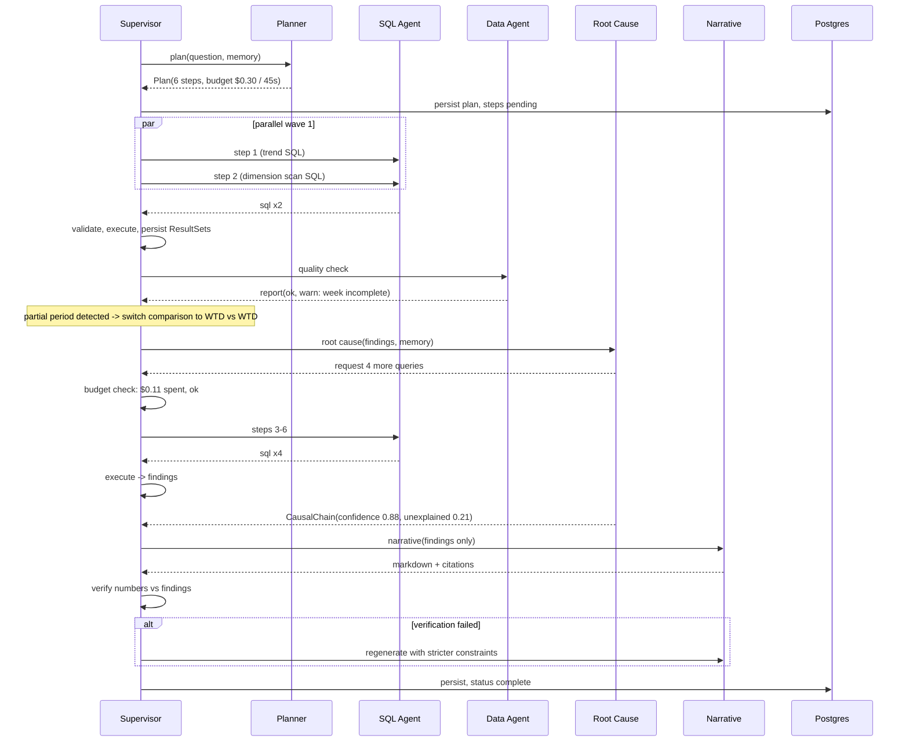

The supervisor owns: budget enforcement (hard stop, degrade gracefully at the cap), retry policy, parallelism and concurrency caps, streaming, and — most importantly — **the decision to stop.** Agent systems that decide their own stopping condition run away. The supervisor holds a step budget, a wall-clock budget, and a dollar budget, and any breach ends the run with whatever evidence exists.

---

# Part 11 — Memory System

## 11.1 Why memory is the moat

Every competitor can call the same model. None of them know that your Q3 target is $4.2M, that you ran a pricing experiment in May, that your "enterprise" segment means >$50k ACV, that revenue always dips in the first week of the fiscal year because of how you recognize renewals, or that three months ago you investigated this exact dip and concluded it was a billing-cycle artifact.

**Memory is the only asset here that appreciates and cannot be copied.** A customer two years in has a system that knows their business better than most of their employees. That is the switching cost.

## 11.2 The three tiers

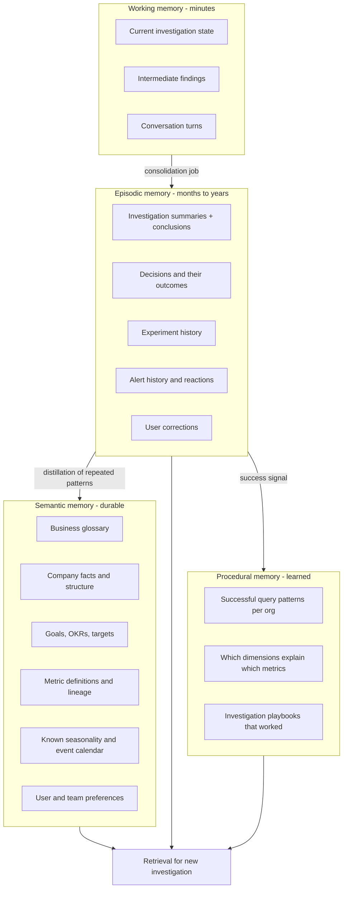

Working memory lives in the run context and Redis. Everything else is `memory_items` in Postgres with pgvector.

## 11.3 What gets stored

| Type | Source | Example | Decay |
|---|---|---|---|
| `glossary` | User, dbt descriptions, inferred | "Enterprise = ACV > $50k" | Never |
| `fact` | Onboarding, connectors, conversation | "Fiscal year starts Feb 1"; "We use a 45-day sales cycle" | Never, but supersedable |
| `okr` / `goal` | User input, `metric_targets` | "Q3 net revenue target $4.2M" | Expires at period end, retained for history |
| `investigation_summary` | Every completed investigation | "Jul 14: revenue -12% → EMEA paid search budget cap hit. Confidence 0.88" | Slow decay; importance-weighted |
| `decision` | Recommendation → user action | "Increased EMEA budget 20% on Jul 15" | Never — this is the gold |
| `experiment` | User-logged or detected | "Pricing test on Pro tier, Apr 3 – May 1" | Never |
| `correction` | User disagrees with the system | "Blended CAC should exclude brand spend" | **Never, highest importance** |
| `preference` | Behaviour + explicit | "CFO wants variance vs. plan first, always" | Slow decay |
| `event` | Slack, Notion, calendar, manual | "Checkout outage Jul 12, 3 hours" | Never — critical causal context |

**`event` deserves special attention.** The single most valuable memory type for root cause analysis is a timeline of things that happened to the business. A revenue dip on July 12 is a mystery until you know there was a three-hour checkout outage. Mining Slack, incident tools, deploy logs, and calendars for a business event timeline — and correlating anomalies against it — is a feature no BI tool has and every analyst does manually.

## 11.4 Retrieval strategy

Naive vector search over all memory returns semantically-similar-but-useless items. The retrieval scoring function matters more than the embedding model:

```
score = w1·semantic_similarity      # pgvector cosine
      + w2·lexical_match            # BM25 over content (entity names, metric keys)
      + w3·recency_decay            # exp(-Δdays / half_life_by_type)
      + w4·importance               # stored, boosted by corrections and user pins
      + w5·entity_overlap           # shares metric_id / dimension / connection with the query
      + w6·access_frequency         # things retrieved often are usually relevant
      - w7·redundancy_penalty       # MMR: diversify, don't return five near-duplicates
```

with a hard pre-filter on `org_id`, `valid_to IS NULL` (or valid at the question's as-of time), and type relevance to the detected intent.

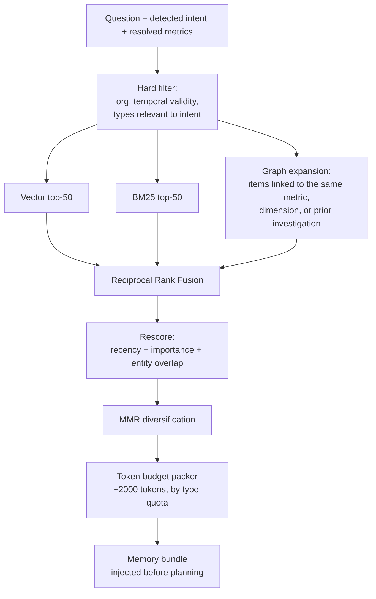

The **token budget packer** enforces per-type quotas so one chatty type cannot crowd out the rest: e.g. ≤400 tokens glossary, ≤400 facts/OKRs, ≤600 prior investigations, ≤300 corrections, ≤300 events. Without quotas, the ten most-similar items are usually ten near-identical investigation summaries and the system forgets the OKR.

**Graph expansion** matters more than people expect: memory items link to metrics, dimensions, and each other. Retrieving "revenue" should pull in the revenue definition, the revenue target, the last revenue investigation, and the correction someone made about revenue — none of which may be top-50 by embedding similarity.

## 11.5 Consolidation

A nightly job per org:
- **Summarize** — investigations older than 30 days collapse into compact summaries; the full record stays queryable but leaves the retrieval pool.
- **Distill** — patterns appearing ≥3 times promote from episodic to semantic ("revenue always dips in week 1 of the quarter" becomes a durable seasonality fact).
- **Supersede** — contradictions detected; older item gets `valid_to`, newer wins, both retained.
- **Decay** — importance decays by type half-life; items below a floor leave the retrieval pool (never deleted).
- **Deduplicate** — near-identical items (cosine > 0.95) merge with a bumped access count.

Without consolidation, memory becomes a landfill by month six and retrieval quality falls off a cliff. This job is not optional.

## 11.6 The correction loop — the most valuable feedback in the product

```mermaid
sequenceDiagram
  actor U as User
  participant S as System
  participant M as Memory
  participant SL as Semantic Layer
  participant E as Eval Set

  S->>U: "Revenue fell 12% driven by Paid Search"
  U->>S: "That's not right — we exclude brand spend from paid search"
  S->>S: classify correction: definition | fact | causal | preference
  S->>M: write correction (importance 1.0, never decays)
  S->>SL: propose metric definition change -> analyst review queue
  S->>E: add question to org eval set with corrected expectation
  S->>U: "Understood. Should I update the paid_search definition permanently?"
  U->>S: yes
  S->>SL: version metric, recompute affected snapshots
  S->>M: link correction to metric version
  S->>U: re-run investigation with corrected definition
```

Three things happen that most products miss: the correction becomes **durable memory** so it is never repeated; it becomes a **proposed semantic layer change** so it is fixed at the source; and it joins the **org's eval set** so a future prompt or model change cannot silently regress it. This is how per-customer accuracy compounds — and compounding accuracy is a moat that a competitor with a better model cannot buy.

---

# Part 12 — Root Cause Engine

## 12.1 The central principle

**Everything in this part is deterministic code. No LLM touches these computations.** The LLM decides *which* analyses to run and *how to explain* the results. The results themselves are statistics, reproducible, testable, and identical on every run.

This is the anti-hallucination architecture, and it is also the moat: statistical machinery does not commoditize when a new model ships.

## 12.2 The analysis cascade

```mermaid
graph TD
  A["Metric movement detected"] --> B["1. Data quality screen<br/>Is this real, or a pipeline artifact?"]
  B -->|artifact| Z["Report data issue. STOP.<br/>Do not explain a phantom."]
  B -->|real| C["2. Seasonality decomposition<br/>STL: trend / seasonal / residual"]
  C --> D["3. Anomaly test on residual<br/>robust z-score + seasonal ESD"]
  D -->|within normal range| Y["Report: variation is within<br/>historical norms. STOP."]
  D -->|anomalous| E["4. Contribution decomposition<br/>across every dimension"]
  E --> F["5. Segment scan<br/>2-way interactions on top slices"]
  F --> G["6. Changepoint detection<br/>when exactly did it start?"]
  G --> H["7. Related-metric correlation<br/>lagged, multiple-testing controlled"]
  H --> I["8. Event correlation<br/>against business event timeline"]
  I --> J["9. Causal test where possible<br/>diff-in-diff / CausalImpact"]
  J --> K["10. Confidence scoring<br/>+ residual accounting"]
  K --> L["11. Evidence ranking"]
  L --> M["Findings -> Root Cause Agent"]
```

Note steps 1 and 3 both terminate the pipeline. **Knowing when there is nothing to explain is as important as explaining.** A system that always finds a cause is a system that always hallucinates one.

## 12.3 The algorithms

### Seasonality — STL decomposition
`statsmodels.tsa.STL` with robust fitting. Separates trend, seasonal, and residual. All anomaly detection runs on the **residual**, not the raw series. Without this, every Monday is an anomaly and every December is a crisis.
- Requires ≥2 full seasonal cycles; below that, fall back to day-of-week medians.
- Multi-seasonality (weekly + annual) via MSTL when history allows.
- Detected seasonality is **written to memory** as a durable fact.

### Anomaly detection — ensemble, not a single test
| Method | Detects | Notes |
|---|---|---|
| **Robust z-score on STL residual** (median/MAD) | Point anomalies | Primary. MAD resists the contamination that kills mean/σ |
| **Seasonal Hybrid ESD** | Multiple anomalies in seasonal data | Handles masking, where one huge outlier hides others |
| **Prediction-interval breach** | Deviation from expected level | Uses the Part 14 forecast as the baseline |
| **CUSUM / Bayesian changepoint** | Level shifts, not spikes | A sustained 5% shift matters more than a one-day 20% spike |
| **Isolation Forest** | Multivariate anomalies | `[P3]` for "this combination of metrics is unusual" |

Ensemble voting with severity from `|residual| / MAD`. Sensitivity is a per-rule setting, because a CFO watching cash and a growth lead watching signups want different thresholds.

### Contribution / mix-shift decomposition — the workhorse
This is the single most valuable algorithm in the product. For a metric that moved from `V0` to `V1` across segments `s`:

**Additive metrics** (revenue, orders, spend):
```
Δ_total = Σ_s (V1_s − V0_s)
contribution_pp_s = (V1_s − V0_s) / V0_total × 100
```
Rank by |contribution|; report the top slices covering ~80% of the movement, plus the residual.

**Ratio metrics** (AOV, conversion rate, CAC) — where naive analysis goes badly wrong. Decompose into **rate effect** vs **mix effect**:
```
Δ_rate_s = w0_s × (r1_s − r0_s)          # the segment's own rate changed
Δ_mix_s  = r0_s × (w1_s − w0_s)          # the segment's share of volume changed
Δ_joint_s = (r1_s − r0_s) × (w1_s − w0_s)
```
This distinguishes *"conversion got worse"* from *"conversion looks worse because more traffic came from a low-converting channel."* Those two facts imply opposite actions, and conflating them is the most common analytical error in business. Getting this right is a demo-winning moment with any experienced operator.

**Multi-dimensional search.** Exhaustive search over all dimension combinations is exponential. Use an **Adtributor-style** greedy approach: score each dimension by explanatory power (JS-divergence between expected and actual distributions), expand only the top 2–3 dimensions to two-way interactions, prune slices below a volume floor. Bounded at ~50 queries. Report `unexplained_share` honestly.

### Correlation — with the guardrails that make it usable
Lagged Pearson and Spearman across related metrics, lags 0–14 days. Three mandatory guards:
1. **Benjamini–Hochberg FDR control.** Testing 40 metrics × 15 lags is 600 tests; at p<0.05 you get 30 false positives by construction. Without FDR control your "insights" are noise.
2. **Minimum sample and effect size.** ≥30 observations, |r| ≥ 0.5. Below that, don't report.
3. **Language discipline.** Correlations are surfaced as `finding_type='correlation'`, and the narrative agent is prompted and *verified* to never render a correlation as a cause. Verification checks for causal verbs attached to correlation findings.

### Changepoint detection
`ruptures` (PELT with an RBF cost) to find when a shift actually began. Enormously useful in practice: "this started on July 8, not last week" reframes the entire investigation and immediately narrows the candidate causes to things that happened on July 8.

### Causal inference `[P3]`
Where a clean intervention exists — a campaign launch, a price change, a feature release — upgrade from correlation to estimation:
- **CausalImpact / Bayesian structural time series** with unaffected segments as synthetic controls. Answers "what would revenue have been without the change?"
- **Difference-in-differences** where a comparable control group exists (a region that didn't get the change).
- **Interrupted time series** for step interventions.
- **DoWhy** for refutation tests (placebo, random common cause) on causal DAGs `[P4]`.

These are the difference between "revenue rose after the campaign" and "the campaign caused an estimated +$142k ±$38k." The second is worth 10x more and is defensible in a budget meeting.

### Contextual signals that punch above their weight
- **Event correlation.** Align anomalies against the memory event timeline (deploys, outages, campaigns, holidays, competitor actions). Cheap, deterministic, and frequently *the* answer.
- **Cohort effects.** Is the drop in new customers or existing ones? This single split resolves a large fraction of revenue questions in one query.
- **Composition drift.** Did the customer mix change? Often the real story behind margin compression.

## 12.4 Confidence scoring

Every finding carries an explicit, formula-driven confidence — never a model's self-assessed vibe.

```python
def confidence(f: Finding) -> float:
    statistical = clamp(1 - f.p_value, 0, 1)              # significance
    effect      = sigmoid(abs(f.effect_size) / f.historical_volatility)
    coverage    = f.explained_share                       # share of movement explained
    data_qual   = f.data_quality_score                    # freshness, completeness, volume
    sample      = sigmoid((f.n_observations - 30) / 30)
    corroborate = min(1.0, 0.6 + 0.2 * f.independent_confirmations)
    replication = 1.0 if f.pattern_seen_before else 0.85

    score = weighted_geometric_mean(
        [statistical, effect, coverage, data_qual, sample, corroborate, replication],
        weights=[0.20, 0.20, 0.20, 0.15, 0.10, 0.10, 0.05],
    )
    return round(score, 3)
```

**Geometric mean, not arithmetic** — deliberately. Any single near-zero component (say, terrible data quality) should collapse the whole score. Arithmetic averaging lets a strong effect size mask stale data, which is exactly the failure mode we must not have.

Confidence maps to enforced narrative language:

| Confidence | Permitted phrasing | UI treatment |
|---|---|---|
| ≥ 0.85 | "caused by", "driven by" | Green, stated as conclusion |
| 0.65–0.85 | "primarily explained by", "the evidence points to" | Amber, stated with hedge |
| 0.45–0.65 | "may be related to", "one possible driver" | Grey, framed as hypothesis |
| < 0.45 | Not shown as a cause; may appear under "worth checking" | Hidden by default |

The verification stage (Part 9, stage 19) enforces this mapping mechanically. **Confidence that does not change the wording is decoration.**

## 12.5 Hallucination defences — the full list

| # | Defence | Layer |
|---|---|---|
| 1 | Numbers come only from executed queries, never model generation | Architecture |
| 2 | Narrative agent has **no tool** that returns raw data | Tool permissions |
| 3 | Every finding requires ≥1 `evidence_result_id` (DB `CHECK` constraint) | Database |
| 4 | Post-generation numeric extraction and cross-check against cited findings | Verification |
| 5 | Causal claims require a finding of causal type above threshold | Verification |
| 6 | Hedging language enforced by confidence band | Verification |
| 7 | Correlation findings cannot be rendered with causal verbs | Verification |
| 8 | `unexplained_share` always reported | Statistics |
| 9 | Data quality gate blocks analysis on stale or incomplete data | Pipeline |
| 10 | Null results are valid, reported outputs | Product design |
| 11 | Full SQL + row-level trace exposed to the user | Transparency |
| 12 | Golden-set eval in CI on numeric fidelity | Process |
| 13 | Two verification failures → degrade to evidence cards, no prose | Fallback |

Defence 13 is the one people resist and the one that matters most: **the system must be willing to produce a less impressive output rather than a wrong one.** Build that switch early, and wire an alert to how often it fires.

---

# Part 13 — Recommendation Engine

## 13.1 Hybrid by design

Pure LLM recommendation gives you plausible generic advice ("consider optimizing your funnel"). Pure rule engines give you rigid advice that ignores context. The architecture is deliberately hybrid, with the rule engine constraining the model rather than replacing it.

```mermaid
graph TD
  CC["Causal chain + findings"] --> RE["Rule Engine<br/>deterministic playbooks"]
  CC --> LLM["LLM Reasoner<br/>context-aware synthesis"]
  MEM["Memory: past decisions,<br/>outcomes, constraints"] --> LLM
  MEM --> RE
  RE --> CAND["Candidate actions"]
  LLM --> CAND
  CAND --> CONST["Constraint filter<br/>budget, policy, capability,<br/>regulatory, brand"]
  CONST --> IMP["Impact estimation<br/>elasticity, historical analogues,<br/>forecast scenarios"]
  IMP --> RISK["Risk scoring<br/>reversibility x blast radius x<br/>confidence x cost"]
  RISK --> PRI["Priority ranking<br/>impact / effort, risk-adjusted"]
  PRI --> OUT["Ranked recommendations<br/>with expected impact + range"]
  OUT --> TRACK["Decision tracking<br/>-> outcome -> memory"]
  TRACK -.improves.-> IMP
```

## 13.2 The rule engine

Rules are declarative YAML, versioned, and — importantly — **authored partly by the customer**, which turns their institutional knowledge into product behaviour.

```yaml
- id: paid_channel_efficiency_decline
  when:
    finding_type: contribution
    metric: cac
    direction: increase
    dimension: channel
    magnitude_pct: ">15"
    sustained_days: ">7"
  and_check:
    - metric: impression_share      # is it auction pressure?
    - metric: ctr                   # or creative fatigue?
    - metric: landing_conversion    # or a site problem?
  then:
    - action: "Reduce daily budget on {{slice.channel}} by 20% and reallocate to {{best_alternative_channel}}"
      condition: "ctr_decline > 0.15 and impression_share_stable"
      expected_impact_fn: "cac_reduction_from_reallocation"
      risk: medium
      reversible: true
      effort: low
    - action: "Refresh creative on {{slice.channel}} — top 3 ads are {{creative_age_days}} days old"
      condition: "ctr_decline > 0.20 and frequency > 3.0"
      risk: low
      reversible: true
      effort: medium
  constraints:
    - "not violates_min_channel_spend"
    - "not within_blackout_period"
```

The `and_check` block is the interesting part: **the rule triggers further investigation before recommending**, because "CAC is up in Meta" has at least four distinct causes with four different correct responses. A recommendation engine that skips the differential diagnosis is a random advice generator.

Rule packs ship per vertical (e-commerce, B2B SaaS, marketplace, agency) so a new customer gets useful behaviour on day one.

## 13.3 Impact estimation

An action without a number is an opinion. Four estimation methods, in descending order of preference:

| Method | When usable | Confidence |
|---|---|---|
| **Historical analogue** | We did this before and measured the result | High. "Last time you raised this budget 20%, CAC rose 6% and volume rose 24%" |
| **Elasticity from observed data** | Enough variation in the historical series to fit a response curve | Medium-high. Diminishing returns on ad spend is a real, fittable curve |
| **Counterfactual forecast** | Forecast with and without the intervention | Medium |
| **Benchmark / heuristic** | Nothing else available | Low. Must be labelled as a heuristic, never as a prediction |

Always expressed as a **range with a confidence level**, never a point: "+$18k to +$34k monthly revenue (60% interval), based on 3 similar past reallocations."

## 13.4 Risk scoring

```
risk = w1·(1 − reversibility)      # can we undo it cheaply?
     + w2·blast_radius             # customers/revenue/employees affected
     + w3·(1 − confidence)         # how sure are we of the diagnosis?
     + w4·cost_magnitude           # dollars at stake
     + w5·external_visibility      # do customers or the market see it?
```

Risk drives the **autonomy gate** — the mechanism by which Stage 6 ("Act") of the vision ladder becomes safe:

| Risk band | Treatment |
|---|---|
| Low, reversible, high confidence | Eligible for auto-execution `[P5]` with notification |
| Medium | One-click execute with explicit approval and a preview of what will change |
| High | Recommend only. Requires named human owner and a written rationale |
| Any risk, confidence < 0.6 | Do not recommend. Suggest investigation instead |

## 13.5 Priority and constraints

`priority = (risk_adjusted_impact / effort) × strategic_alignment × urgency_decay`

`strategic_alignment` comes from memory: a recommendation that moves a metric tied to a current OKR outranks one that doesn't, even at equal raw impact. This is what makes recommendations feel like they came from someone who works at the company.

Business constraints are hard filters loaded from memory and org settings — budget floors and ceilings, contractual commitments, blackout periods, brand-safety policies, regulatory limits, headcount and capability limits. A recommendation that violates a constraint is never shown, not shown-and-caveated. Recommending something the company literally cannot do destroys credibility instantly.

## 13.6 The learning loop

```mermaid
stateDiagram-v2
    [*] --> Proposed
    Proposed --> Accepted: user commits
    Proposed --> Rejected: user declines
    Proposed --> Expired: no action, 30d
    Rejected --> [*]: capture reason -> memory
    Accepted --> InProgress: owner + due date
    InProgress --> Measuring: action executed
    Measuring --> Succeeded: impact >= 50% of predicted
    Measuring --> Partial: 0 < impact < 50%
    Measuring --> Failed: no impact or adverse
    Succeeded --> [*]: reinforce rule + calibrate estimator
    Partial --> [*]: recalibrate
    Failed --> [*]: demote rule, record why
```

Measuring outcomes is what turns recommendations from advice into an accumulating asset. After a year the system can say: *"You've made this reallocation four times; it worked three times, and the failure was in December when seasonality dominated."* No competitor can produce that sentence about your business.

---

# Part 14 — Forecasting

## 14.1 Model selection policy

Do not use one model for everything. Automatically select via backtesting, and **always include a naive baseline as a floor** — if you cannot beat seasonal-naive, ship seasonal-naive and say so.

```mermaid
graph TD
  S["Time series"] --> H{"History length"}
  H -->|"< 2 seasonal cycles"| N["Seasonal naive / drift<br/>+ explicit low-confidence warning"]
  H -->|">= 2 cycles"| C{"Characteristics"}
  C -->|"Strong multi-seasonality,<br/>holidays, known events"| P["Prophet or NeuralProphet"]
  C -->|"Clean univariate,<br/>stable structure"| E["ETS / ARIMA via statsmodels"]
  C -->|"Has exogenous drivers<br/>spend, traffic, headcount"| G["Gradient boosting<br/>LightGBM w/ lag features"]
  C -->|"Many related series<br/>e.g. per-SKU, per-account"| GL["Global model<br/>LightGBM pooled, or TFT [P4]"]
  C -->|"Count / intermittent<br/>e.g. sparse SKU demand"| CR["Croston / TSB"]
  P --> BT["Backtest:<br/>rolling-origin CV"]
  E --> BT
  G --> BT
  GL --> BT
  CR --> BT
  N --> BT
  BT --> SEL["Select best MAPE/pinball;<br/>ensemble top 2 if close"]
  SEL --> PI["Prediction intervals:<br/>conformal prediction"]
  PI --> OUT["Forecast + interval + drivers + caveats"]
```

**Conformal prediction for intervals** rather than model-native intervals. Model-native intervals are notoriously overconfident — Prophet's are famously narrow. Conformal intervals are distribution-free and empirically calibrated on your actual backtest residuals, which means when we say 80%, it is roughly 80%. In a product where an executive commits to a board number based on our range, calibration is an ethical requirement, not a technical nicety.

## 14.2 Per-domain treatment

| Forecast | Primary model | Key drivers | Special handling |
|---|---|---|---|
| **Revenue** | LightGBM w/ exogenous, or Prophet | Pipeline, spend, seasonality, price | Decompose into volume × price × mix and forecast components separately — far more accurate and far more explainable |
| **MRR / ARR** | Cohort-based accounting model, not a curve fit | New, expansion, contraction, churn | **Never curve-fit MRR.** Build it from components: existing base − churn + expansion + new. This is both more accurate and directly actionable |
| **Demand / units** | LightGBM global model across SKUs | Price, promo, seasonality, stock-outs | Censored demand — a stock-out looks like low demand. Must correct for it or you under-order forever |
| **Inventory** | Demand forecast + lead-time distribution | Demand, lead time variance, service level | Output is a reorder point and safety stock, not a forecast: `SS = z·σ_LT` |
| **Traffic** | Prophet (strong multi-seasonality) | Spend, seasonality, SEO trend | Handle bot filtering and tracking changes as changepoints |
| **Leads** | LightGBM w/ spend regressors | Spend by channel, seasonality | Model saturation explicitly — linear spend→lead extrapolation is the classic and expensive error |
| **Cash flow** | Deterministic schedule + probabilistic collections | AR aging, AP terms, payroll, revenue forecast | Mostly accounting, partly forecast. Scenario-first: base/downside/upside |
| **Churn** | Per-customer classifier (LightGBM/XGBoost) + survival model | Usage trend, support tickets, payment failures, engagement decay, contract dates | Two outputs: a ranked at-risk list with **SHAP-based reasons**, and an aggregate churn rate forecast. The reason matters more than the score — "at risk" is useless, "at risk because usage dropped 60% after their champion left" is actionable |

## 14.3 Practical requirements

- **Backtest everything, always.** Rolling-origin cross-validation with a gap. Report MAPE, sMAPE, and pinball loss for intervals. Store results with the forecast. A forecast without a backtest is a guess with decoration.
- **Reforecast on schedule** and track drift. When live error exceeds backtest error by 50%, flag it and re-select the model.
- **Explain drivers.** SHAP for tree models, component plots for decomposition models. "The forecast is up because pipeline coverage is 3.2x vs. 2.4x last quarter" is what the user needs.
- **Scenarios, not just forecasts.** "What if we cut ad spend 30%?" is the question people actually ask. Support intervention scenarios on exogenous variables.
- **Refuse when appropriate.** Fewer than 2 seasonal cycles, or a recent structural break, means the honest answer is "I can give you a naive projection but I would not plan against it, because your business changed shape in April."

---

# Part 15 — Visualization Engine

## 15.1 The generation model

The Visualization Agent emits a **Vega-Lite JSON spec**, which is validated against the Vega-Lite JSON schema and against our own safety rules before rendering. The pipeline is:

```mermaid
graph LR
  R["ResultSet schema<br/>+ column semantics"] --> RULES["Deterministic selector<br/>covers ~80% of cases"]
  F["Finding type"] --> RULES
  A["Audience"] --> RULES
  RULES --> OK{"Confident<br/>match?"}
  OK -->|yes| SPEC["Build spec from template"]
  OK -->|no| AGENT["Viz Agent<br/>generates spec"]
  AGENT --> V["Schema validation<br/>+ safety rules"]
  SPEC --> V
  V -->|invalid| FB["Fallback: table"]
  V -->|valid| TH["Apply theme +<br/>annotate findings"]
  TH --> OUT["Rendered chart<br/>+ PNG for email/PDF"]
```

Rules first, agent second. The rule engine is instant, free, and correct for the vast majority of cases; the agent handles the long tail. Running the agent for every chart is a latency and cost mistake.

## 15.2 Selection rules

| Data shape / finding | Chart | Why |
|---|---|---|
| Metric over time, 1 series | **Line** with anomaly markers and forecast band | Standard, readable |
| Metric over time, 2–5 series | Multi-line | Above 5, small multiples instead |
| Metric over time, >5 categories | **Small multiples** or stacked area | Overlaid spaghetti is unreadable |
| Contribution to a change | **Waterfall** | Purpose-built for "what made up this delta" — this is the signature chart of the whole product |
| Categorical comparison, ≤12 items | Horizontal bar, sorted by value | Horizontal because labels are readable |
| Categorical, >12 items | Top N + "other", with a table below | Never render 40 bars |
| Part-to-whole | Stacked bar or treemap. **Never a pie** | Pie charts are unreadable above 3 slices |
| Two dimensions × 1 measure | **Heatmap** | Immediately surfaces where the problem concentrates |
| Two measures, entity per point | Scatter with quadrant lines and trend | e.g. spend vs. ROAS by campaign |
| Sequential stage drop-off | **Funnel** with stage conversion labels | |
| Retention by acquisition cohort | **Cohort triangle heatmap** | |
| Distribution | Histogram or box plot | Averages hide bimodality — show the shape |
| Actual vs. target | **Bullet chart** | Compact, exec-friendly |
| Single number, with context | **Big number + sparkline + delta vs. comparison** | The most-used component in the product |
| Uncertainty / forecast | Line + shaded interval band | Never a bare point forecast |
| >3 dimensions, no clear story | **Table** with inline bars and conditional formatting | Honesty beats a bad chart |

## 15.3 Chart design commitments

These are not aesthetics; they are correctness.

- **Annotate the finding on the chart.** The chart must show *why it was included* — mark the anomalous point, shade the changepoint, label the contributing segment. An unannotated chart makes the reader hunt.
- **Never truncate a bar-chart y-axis at nonzero.** Bars encode magnitude by length; truncation lies. Line charts may truncate, with the axis clearly labelled.
- **Consistent color semantics org-wide.** One color per channel/region/segment across every chart, assigned deterministically by hashing the dimension value so it is stable across sessions.
- **Directional color follows `higher_is_better`.** A rising CAC is red; rising revenue is green. Hardcoding "up is green" is wrong for half of all metrics.
- **Color-blind safe palettes by default** (Okabe-Ito derived), and never encode information by color alone.
- **Format from the semantic layer.** Currency, percent, and unit come from the metric definition, not from the agent's guess.
- **Every chart is exportable** as PNG (server-side Vega render for email/PDF), SVG, CSV, and as the underlying SQL.

## 15.4 Executive dashboards

Auto-generated, not hand-built, and structurally different from a BI dashboard: **a section per *question*, not per chart.**

```
┌─────────────────────────────────────────────────────────┐
│  HEADLINE:  Revenue is 8% behind plan for the quarter   │
│  [Big number]  [vs plan]  [vs last year]  [trend spark] │
├─────────────────────────────────────────────────────────┤
│  WHAT CHANGED                                            │
│  • EMEA paid search −18% ▼  [waterfall of contributions] │
│  • Enterprise expansion +12% ▲                           │
├─────────────────────────────────────────────────────────┤
│  WHY  — root cause with confidence badge and evidence    │
├─────────────────────────────────────────────────────────┤
│  WHAT'S NEXT — forecast with interval vs plan            │
├─────────────────────────────────────────────────────────┤
│  RECOMMENDED ACTIONS — ranked, with expected impact      │
└─────────────────────────────────────────────────────────┘
```

Every element is drillable into the underlying investigation and its full trace. The dashboard is a *view over investigations*, which means it is never stale and never needs maintenance — the structural advantage over every BI tool on the market.

---

# Part 16 — Alert Engine

## 16.1 The hard problem is precision, not detection

Detecting anomalies is easy. **Detecting anomalies that a human cares about is the entire product.** Every BI tool has threshold alerts, and in practice every one of them ends up muted, because a 20% false positive rate on a daily alert means a user learns to ignore them within two weeks.

Target: **>40% of alerts marked useful.** Measure it from day one via `alert_events.user_feedback`. If you cannot hit 40%, ship fewer alerts, not more.

## 16.2 Architecture

```mermaid
graph TD
  SCHED["Scheduler<br/>hourly / daily per metric tier"] --> SCAN["Snapshot scanner<br/>reads metric_snapshots,<br/>NOT the customer warehouse"]
  SCAN --> DET["Detection ensemble<br/>Part 12.3"]
  DET --> DQ{"Data quality<br/>gate"}
  DQ -->|"sync stale / volume drop"| DATA_ALERT["Data pipeline alert<br/>to admins only"]
  DQ -->|clean| SIG{"Statistically<br/>significant?"}
  SIG -->|no| DROP1["Discard"]
  SIG -->|yes| MAT{"Materially<br/>significant?<br/>abs + rel thresholds"}
  MAT -->|no| DROP2["Discard"]
  MAT -->|yes| CLUST["Cluster related anomalies<br/>one root event, not 40 alerts"]
  CLUST --> DEDUP{"dedup_key seen<br/>in window?"}
  DEDUP -->|yes| SUPPRESS["Suppress, increment count"]
  DEDUP -->|no| NOVEL{"Novel vs.<br/>known seasonality<br/>and prior causes?"}
  NOVEL -->|"known pattern"| DROP3["Discard or downgrade to digest"]
  NOVEL -->|novel| INV["Auto-investigate<br/>root cause"]
  INV --> SEV["Severity scoring<br/>magnitude x business impact x<br/>metric importance x confidence"]
  SEV --> ROUTE["Routing<br/>who cares about this metric?"]
  ROUTE --> PREF["Preferences<br/>quiet hours, channel, frequency cap"]
  PREF --> SEND["Deliver:<br/>Slack / email / in-app / SMS"]
  SEND --> FB["Feedback capture<br/>useful / not useful / already knew"]
  FB -.tunes thresholds.-> MAT
  FB -.tunes routing.-> ROUTE
```

**Two structural decisions.**

First: **detection scans `metric_snapshots`, not the customer's warehouse.** Hourly anomaly detection across 60 metrics × 8 dimensions against a customer's Snowflake would cost them thousands of dollars a month and get us fired. The snapshot table (Part 6.2) is what makes continuous monitoring economically possible. This is why that table exists.

Second: **alerts arrive with the root cause already attached.** "Revenue down 12%" is an interruption. "Revenue down 12%, driven by EMEA paid search hitting its budget cap on Tuesday — here's the evidence and two suggested actions" is *the product*. Auto-investigating before notifying costs $0.17 and transforms the alert from a chore into the moment the customer decides to renew.

## 16.3 What we monitor

| Category | Examples | Detection emphasis |
|---|---|---|
| **Revenue** | Revenue, MRR, AOV, margin, refunds, failed payments | Level shifts and trend breaks over point spikes |
| **Marketing** | CAC, ROAS, CTR, spend pacing, conversion rate, creative fatigue | Pacing and efficiency; ratio decomposition to separate rate from mix |
| **Customer** | Churn risk, NPS, support volume, usage decline, at-risk accounts | Per-account survival models, not just aggregates |
| **Inventory / ops** | Stock-outs, days of cover, fulfilment SLA, handle time | Forward-looking: alert before the stock-out, not after |
| **Pipeline / sales** | Coverage ratio, stage conversion, deal slippage, rep trajectory | Snapshot-derived stage transitions |
| **System / data** | Sync freshness, row volume, schema drift, null spikes, query failures | Routed to admins, never to executives |

## 16.4 Rule types

| Type | Config | Use |
|---|---|---|
| `threshold` | `metric < X` | Hard business limits: cash below runway floor |
| `change` | `Δ% > X over N periods` | Simple and legible; the default users understand |
| `anomaly` | statistical, sensitivity low/med/high | The good one; seasonality-aware, self-calibrating |
| `forecast_breach` | prediction interval or plan breach | "You will miss the quarter" — the most valuable alert type there is |
| `composite` | boolean combination | "CAC up AND conversion flat" — high precision, low recall |
| `absence` | expected event did not occur | Underrated: "no orders in 6 hours" catches outages faster than monitoring does |
| `segment_emergence` | a slice newly deviates | Catches localized problems long before the aggregate moves |

## 16.5 Suppression — the machinery that earns trust

Every mechanism below exists to lower alert volume, and each one directly raises usefulness rate:

- **Dedup key** — `hash(rule, dimension_slice, anomaly_cluster, period_bucket)`. Same problem, one alert, with an occurrence counter.
- **Clustering** — a single event that moves 40 metrics produces one alert about the root event, not 40 alerts. Cluster by temporal proximity and by shared causal findings.
- **Known-pattern suppression** — memory knows revenue dips in week 1 of the quarter. Do not alert on a pattern the system has already learned and explained.
- **Frequency caps** — per user, per day, per severity. Overflow goes into the digest.
- **Quiet hours and timezone awareness** — critical only, outside working hours.
- **Escalating thresholds** — if a user marks a rule "not useful" twice, automatically lower its sensitivity and tell them you did.
- **Digest batching** — anything below `high` severity is batched into the daily brief. **Most alerts should be digest items, not interruptions.** Reserve real-time push for things worth interrupting a human for.

## 16.6 Delivery and the daily brief

Slack is the primary channel for most teams — an alert with a chart, the root cause, and inline "useful / not useful / investigate further" buttons. Email carries the daily brief and weekly review. SMS/push is for critical only. In-app is the full inbox with history.

The **daily brief** is the retention engine, and it should follow a strict structure that respects the reader's time:

1. **Headline** — the one thing that matters today, or explicitly "nothing unusual."
2. **Movements** — 3–5 metrics that moved materially, with cause attached.
3. **Watch list** — things trending toward a threshold, with time-to-breach.
4. **Progress** — OKR/plan tracking with forecast-to-period-end.
5. **Suggested actions** — at most 3, ranked.

And the discipline that makes it work: **on a quiet day, send a two-line note saying everything is normal.** A digest that manufactures drama to justify its existence gets unsubscribed. A digest that reliably says "all clear" in ten words on quiet days is one an executive reads every morning for years.

---

# Part 17 — Security

## 17.1 Threat model first

Security decisions only make sense against a threat model. Ours has five entries, ranked by expected damage:

| # | Threat | Why it ranks here | Primary control |
|---|---|---|---|
| 1 | **Cross-tenant data leakage** | Company-ending. One incident and every enterprise deal dies | Postgres RLS + per-org credential scoping + tenant-filter assertion in the SQL validator |
| 2 | **Credential compromise** (warehouse creds, OAuth tokens) | We hold keys to customers' entire data estate | KMS envelope encryption, Secrets Manager, read-only scopes, short-lived tokens, no creds in the app DB |
| 3 | **SQL injection via generated SQL** | Our core function is generating SQL | AST-level validation, read-only DB roles, parameterization, allowlisted tables |
| 4 | **Prompt injection via data** | A Slack message or a CRM field can contain "ignore previous instructions" | Data/instruction separation, tool-level permissions, output validation, no privileged tools in data-reading contexts |
| 5 | **Data exfiltration via LLM provider** | Enterprise deal-blocker; also a genuine privacy risk | Zero-retention agreements, PII redaction before inference, aggregate-only context, BYO-model option |

Threat 4 deserves elaboration because it is new and under-appreciated. **Our agents read customer data, and customer data is attacker-controllable.** A CRM "notes" field, a Zendesk ticket, a Slack message, a product name — any of these can carry injected instructions. Defences: (a) all retrieved data is passed in clearly delimited, labelled blocks that the system prompt declares to be untrusted content; (b) agents that read data have no privileged tools — the Root Cause Agent cannot send notifications or write memory directly, it returns a request to the supervisor; (c) all agent output is schema-validated, so an injected instruction cannot produce a syntactically valid malicious action; (d) any generated SQL still passes the AST validator regardless of where it came from. **Layer (b) is the important one: capability restriction, not prompt hardening, is what actually stops this class of attack.**

## 17.2 RBAC

Five system roles plus custom roles per org:

| Role | Can |
|---|---|
| `owner` | Everything, including billing and deletion |
| `admin` | Manage members, connections, metrics, alerts; view audit log |
| `analyst` | Define and certify metrics, create alerts, run any investigation, see all SQL |
| `member` | Ask questions, view investigations, create personal alerts |
| `viewer` | View shared investigations and dashboards only |

Permissions are `resource:action` (`metric:certify`, `connection:create`, `investigation:read_all`). Checks happen at the service layer, not the router, so every caller — HTTP, worker, Slack, scheduled job — is subject to them.

**Data-level permissions matter more than feature-level ones.** Three mechanisms:
- **Connection-level** — which roles can query which connections.
- **Metric-level** — a `revenue_by_employee` metric may be restricted to `owner`.
- **Row-level pass-through `[P3]`** — the strategically important one. Rather than reimplementing the customer's row-level security, execute queries using **per-user warehouse credentials or OAuth identity pass-through** so Snowflake/BigQuery enforces their existing RLS natively. This is more secure, and it removes an entire category of enterprise security objection. Design the executor's credential resolution as `get_credentials(org, user, connection)` from the start so this is an implementation swap.

## 17.3 Authentication

WorkOS AuthKit handles email/password, social, SAML SSO, OIDC, and SCIM directory sync. Our side: short-lived JWT access tokens (15 min) with refresh rotation and reuse detection, mandatory MFA for `owner`/`admin`, session revocation on role change, and device/session listing.

API keys are hashed (Argon2id) with only a display prefix stored, scoped to org + permission set, expiring, rotatable with an overlap window, and rate-limited per key. **A secret-scanning GitHub Action plus automatic revocation on leak detection** — because customer keys will end up in public repos, and catching it before an attacker does is worth the afternoon it takes to build.

## 17.4 Encryption and secrets

- **In transit** — TLS 1.3 everywhere, including internal service hops and warehouse connections. Certificate pinning for connector callbacks.
- **At rest** — AES-256 via KMS on RDS, S3, and EBS.
- **Field-level** — connector credentials and any PII columns get envelope encryption with a **per-org KMS data key**. Compromising the database alone yields ciphertext; you also need KMS access, and KMS access is separately logged and alarmed.
- **Key rotation** — annual for CMKs, 90 days for data keys, automatic for OAuth tokens.
- **Secrets** — AWS Secrets Manager, referenced by ARN. Never in env vars in a way that lands in a container image, never in the app DB, never in logs (structured logger has a redaction filter with a test asserting it).
- `[P4]` **BYOK/CMK** for enterprises who want to hold the key and thereby the ability to revoke our access unilaterally. This is a common procurement requirement above ~$100k ACV.

## 17.5 Audit logging

Every state change and every data access writes to `audit_logs`: actor (user or agent — agent actions are attributed to the triggering user with `actor_type='agent'`), action, resource, before/after diff, IP, user agent, request ID, timestamp.

Requirements: append-only (no UPDATE/DELETE grant on the table to the app role), exportable to the customer's SIEM via S3 or webhook `[P3]`, 7-year retention with cold storage tiering, and — because trust is the product — **user-visible**. An admin should be able to see every question anyone asked and every query that ran. Hiding this is both a compliance risk and a missed trust opportunity.

## 17.6 Privacy, GDPR, and LLM data handling

| Requirement | Implementation |
|---|---|
| Right to access | Self-serve data export per user and per org |
| Right to erasure | Cascade delete with a documented 30-day window; a `deletion_jobs` table tracks completion across Postgres, S3, and vector indexes |
| Data minimization | We do not copy warehouse data in federated mode. Result sets have TTL-based expiry |
| Purpose limitation | Data is never used to train shared models. Contractual and technical |
| DPA + sub-processors | Published list, notification on change |
| Data residency `[P4]` | EU region deployment; org-pinned region |
| PII in prompts | Redaction pass before inference: emails, phones, names, addresses replaced with stable tokens, rehydrated after generation |
| LLM provider terms | **Zero-retention, no-training agreements with every provider.** Non-negotiable, and the first question every enterprise asks |
| Aggregate-only context | The narrative agent sees findings and aggregates. Raw customer rows rarely reach a model at all — this is a privacy benefit that falls out of the anti-hallucination architecture |
| BYO model `[P4]` | Bedrock or Azure OpenAI in the customer's own account for the most sensitive buyers |

That last row about aggregates is worth selling explicitly. Because our architecture computes statistics in code and sends only *findings* to the model, the volume of customer data crossing an LLM boundary is a tiny fraction of what a "dump the rows into the context window" competitor sends. **A security architecture that is also an accuracy architecture is a rare and valuable coincidence — use it in sales.**

## 17.7 SOC 2 and compliance sequencing

Do not start SOC 2 in month one; do not start it in month twenty-four either. Practical sequencing:

| When | Action |
|---|---|
| Month 1 | Security basics that are free early and expensive later: SSO, audit log, encryption, least-privilege IAM, dependency scanning, no shared accounts |
| Month 4–6 | Vanta or Drata; write policies; enable continuous monitoring. **Type I** achievable in ~6 weeks |
| Month 9–12 | **SOC 2 Type II** — requires a 3–6 month observation window, so the clock must start before you need the report |
| Month 12+ | Annual penetration test, published trust center |
| As demanded | ISO 27001 (Europe), HIPAA (health customers), GDPR/DPF |

The practical rule: **the controls are cheap if designed in and brutal if retrofitted.** Enabling audit logging on day one costs an afternoon; adding it to a two-year-old codebase with 200 mutation sites costs a month.

## 17.8 Application security baseline

Input validation via Pydantic on every boundary. Output encoding and a strict CSP. CSRF tokens on cookie-authenticated routes. Rate limiting per user, per org, per IP, per endpoint class. Idempotency keys on all mutations. Dependency scanning (Dependabot + `pip-audit` + Trivy on images) with CI failing on high severity. SAST via CodeQL, secret scanning via gitleaks. Quarterly threat-model review. Annual third-party pentest once you have enterprise customers.

---

# Part 18 — Scalability

## 18.1 Load model

Scaling this product is not about HTTP requests — the API tier is trivially scalable. It is about three specific resources: **LLM inference throughput and cost, warehouse query concurrency, and the snapshot/alert scan.** Everything below focuses there.

Assumptions per active user: ~8 questions/day, of which ~35% are diagnostics; org averages 12 users; ~60 monitored metrics per org; snapshot scans hourly for tier-1 metrics, daily for the rest.

| Scale | Orgs | Investigations/day | Diagnostics/day | Peak QPS | Warehouse queries/day | LLM spend/mo |
|---|---|---|---|---|---|---|
| 100 users | ~10 | 800 | 280 | 2 | ~4k | ~$1.5k |
| 1,000 users | ~85 | 8k | 2.8k | 15 | ~45k | ~$15k |
| 10,000 users | ~850 | 80k | 28k | 120 | ~450k | ~$150k |
| 100,000 users | ~8k | 800k | 280k | 900 | ~4.5M | ~$1.2M |
| 1,000,000 users | ~80k | 8M | 2.8M | 7,000 | ~45M | ~$9M |

## 18.2 Bottlenecks in the order you will actually hit them

```mermaid
graph TD
  A["100 users<br/>Bottleneck: nothing technical.<br/>It is accuracy and onboarding."] --> B
  B["1k users<br/>Bottleneck: LLM latency + cost per investigation.<br/>Warehouse concurrency limits per customer."] --> C
  C["10k users<br/>Bottleneck: Postgres write throughput on<br/>snapshots/traces. Worker fleet sizing.<br/>Alert scan fan-out."] --> D
  D["100k users<br/>Bottleneck: Single-region Postgres.<br/>Vector index size. Connector fleet.<br/>LLM provider rate limits."] --> E
  E["1M users<br/>Bottleneck: Multi-region data gravity.<br/>Cost structure. Organizational."]
```

### 100 users — do not optimize anything
Single Fargate service (2 tasks), one worker, one Postgres, one Redis. Costs roughly $600/month of infrastructure. **The only bottleneck is product quality.** Any engineering time spent on scale here is time stolen from accuracy. Instrument thoroughly so you can see the next bottleneck arrive, and otherwise leave it alone.

### 1,000 users — LLM cost and latency
This is where the AI economics become real.
- **Semantic caching.** Embed the question; if a semantically equivalent question was answered for this org within the freshness window, return the cached investigation with a "refresh" affordance. In practice 25–40% of questions are repeats. This is the single highest-ROI optimization in the product.
- **Aggressive intent routing.** Ensure the 60% of `lookup`/`definitional` questions never touch a frontier model.
- **Prompt caching** on the provider side for the large stable prefix (semantic catalog, system prompt) — a substantial cost reduction for near-zero work.
- **Batch the non-interactive.** Digests, snapshot summaries, and alert copy go through batch APIs at roughly half price.
- **Warehouse concurrency.** Per-org query concurrency caps and a queue, so a heavy investigation cannot saturate a customer's Snowflake warehouse. Their DBA noticing us as their top consumer is a churn event.
- Split worker pools by class: `interactive`, `sync`, `alerts`, `batch`. A backfill must never delay a user's question.

### 10,000 users — Postgres write throughput and fan-out
- **Partition and tier.** `investigations`, `investigation_steps`, `queries`, `llm_calls`, `audit_logs`, `metric_snapshots` partitioned monthly; partitions older than 90 days moved to S3/Iceberg with a DuckDB-backed read path.
- **Read replicas** for analytics, admin, and the alert scanner.
- **Move trace/telemetry writes off the hot path** — step traces go to Redis Streams and are drained in batches rather than being written synchronously per step.
- **Alert scan fan-out** — 850 orgs × 60 metrics × 8 dimension slices is ~400k series to evaluate hourly. Evaluate in vectorized batches over partitioned snapshot reads rather than row-by-row, and stagger org schedules across the hour.
- **`[P3]` Temporal** for investigation workflows — at this volume, runs failing on deploy becomes a daily user-visible problem.
- **Connection pooling** via PgBouncer in transaction mode. Note the interaction with RLS: session variables must be set inside the transaction, not on the connection.

### 100,000 users — sharding and regionalization
- **Shard Postgres by org** using a directory service. Because every table already carries `org_id` and every query is org-scoped by RLS, sharding is a routing change rather than a schema change. **This is the payoff for the tenancy decision in Part 3.5.**
- **Multi-region** — EU and US cells with org-pinned residency. Cell-based architecture: each cell is a complete stack serving a subset of orgs, which also caps blast radius.
- **Vector index** — beyond ~50M vectors, move memory embeddings out of pgvector into a dedicated store behind the existing `VectorStore` protocol.
- **LLM provider limits** become a real ceiling: multi-provider routing, provisioned throughput, and a fine-tuned small model for the highest-volume narrow tasks (intent classification, metric resolution reranking).
- **Kafka/Redpanda** finally justified: multiple independent consumers, replay, and cross-cell event flow.
- **EKS** finally justified: bin-packing heterogeneous workloads at this scale saves real money.

### 1,000,000 users — structural
At this scale the constraints are economic and organizational rather than technical. Gross margin is dominated by inference; expect meaningful investment in distilled in-house models for the high-volume paths, and in tiered service levels where premium accounts get frontier models and self-serve tiers get distilled ones. Data gravity forces genuinely regional architecture. The engineering organization, not the software, becomes the bottleneck — which is when the modular monolith's enforced boundaries pay for themselves by allowing clean team ownership and service extraction.

## 18.3 Performance targets

| Operation | p50 | p95 | p99 |
|---|---|---|---|
| API read (cached) | 40ms | 120ms | 300ms |
| Metric resolution | 200ms | 500ms | 1s |
| `lookup` investigation, end-to-end | 2s | 5s | 10s |
| `diagnostic`, first token | 1.5s | 3s | 6s |
| `diagnostic`, complete | 25s | 50s | 90s |
| Alert scan per org | 3s | 10s | 30s |
| Connector sync, incremental | 30s | 3min | 15min |

**Time-to-first-token is the metric that governs perceived speed.** A 30-second diagnostic that streams the plan at 1.5s and evidence cards progressively feels responsive; the same 30 seconds behind a spinner feels broken. Optimize the stream before you optimize the total.

## 18.4 Cost model and unit economics

| Cost driver | Control |
|---|---|
| LLM inference | Intent routing, model tiering, semantic caching, prompt caching, batch API, distillation at scale |
| Warehouse compute | Result caching, snapshot tables instead of live scans, cost estimation before execution, per-org byte budgets |
| Our infrastructure | Fargate autoscaling, S3 lifecycle policies, partition tiering |
| Vector storage | Memory consolidation and decay (Part 11.5) genuinely bounds growth |

Meter everything per org into `usage_records` and expose gross margin per account internally. **An AI product where you cannot see per-customer COGS will eventually discover that its largest customer is unprofitable**, and will discover it at the worst possible moment. Build the margin dashboard in month two.

---

# Part 19 — DevOps

## 19.1 Environments

| Env | Purpose | Data | Deploy |
|---|---|---|---|
| Local | Development | Synthetic fixtures | `docker compose up` |
| Preview | Per-PR | Neon branch + seeded fixtures | Automatic on PR |
| Staging | Pre-prod verification | Anonymized subset | Automatic on merge to main |
| Production | Live | Real | Promoted from staging, gated |

Preview environments are worth the setup cost for this product specifically, because reviewing a change to an agent means *using* it, not reading a diff.

## 19.2 CI/CD

```mermaid
graph LR
  PR["Pull request"] --> L["Lint + typecheck<br/>ruff, mypy strict, eslint, tsc"]
  L --> AR["Architecture tests<br/>import-linter boundaries"]
  AR --> U["Unit tests<br/>coverage gate 80%,<br/>95% on services/evidence"]
  U --> I["Integration tests<br/>testcontainers: PG, Redis, DuckDB"]
  I --> S["Security<br/>CodeQL, gitleaks,<br/>pip-audit, Trivy"]
  S --> E["AI EVALS<br/>golden set"]
  E --> B["Build + sign images<br/>multi-stage, distroless, SBOM"]
  B --> P["Deploy preview env"]
  P --> RV["Human review"]
  RV --> M["Merge to main"]
  M --> ST["Deploy staging<br/>+ smoke + E2E"]
  ST --> CAN["Canary: 5% prod traffic<br/>30 min bake"]
  CAN --> MET{"Error rate,<br/>latency, eval scores,<br/>cost per investigation<br/>within bounds?"}
  MET -->|no| RB["Auto-rollback"]
  MET -->|yes| FULL["Progressive rollout<br/>25% -> 50% -> 100%"]
```

## 19.3 Architecture tests — enforce the boundaries or lose them

```toml
# .importlinter
[importlinter:contract:layers]
name = "Layered architecture"
type = "layers"
layers = ["apps", "agents", "services", "shared"]

[importlinter:contract:services-are-framework-free]
name = "Services must not import web framework"
type = "forbidden"
source_modules = ["services"]
forbidden_modules = ["fastapi", "starlette"]

[importlinter:contract:services-never-call-agents]
name = "Services must not depend on agents"
type = "forbidden"
source_modules = ["services"]
forbidden_modules = ["agents"]

[importlinter:contract:evidence-is-llm-free]
name = "Evidence engine must never call an LLM"
type = "forbidden"
source_modules = ["services.evidence"]
forbidden_modules = ["litellm", "anthropic", "openai", "agents"]
```

That last contract is the most valuable line of configuration in the repository. It makes the central architectural principle — *statistics are deterministic* — a **compile-time guarantee** rather than a matter of discipline. Discipline erodes under deadline; CI does not.

## 19.4 AI evaluation in CI — the non-negotiable one

Traditional testing cannot validate a probabilistic system, and shipping prompt changes without evals is how you wake up to a regression you cannot explain.

The golden set contains 200+ questions across intents, each with expected metric resolution, expected SQL semantics, expected findings, and expected numeric answers, over the synthetic fixture companies with **planted ground truth** (a known injected revenue drop with a known cause).

| Eval | What it measures | Gate |
|---|---|---|
| Metric resolution accuracy | Correct `MetricRef` from NL | ≥95%, no regression |
| SQL execution accuracy | Generated SQL returns correct values | ≥90% |
| Root cause recall | Did we find the planted cause? | ≥85% |
| Root cause precision | Did we assert causes that aren't there? | ≥90% |
| **Numeric fidelity** | Every number in narrative traces to evidence | **100%. Hard fail.** |
| Hedging correctness | Language matches confidence band | ≥95% |
| Refusal correctness | Says "I don't know" when it should | ≥90% |
| Cost per investigation | Regression guard on COGS | ≤ baseline + 20% |
| Latency p95 | Regression guard | ≤ baseline + 20% |

Runs on every PR touching `agents/` or `services/semantic/`, and nightly against production model versions to catch **provider-side model drift** — a real phenomenon that will otherwise degrade your product with no code change and no explanation.

Each customer also accumulates their own eval set from corrections (Part 11.6). Before a prompt change reaches an org, it must pass that org's set. This is how you promise enterprise customers that upgrades will not silently break their answers.

## 19.5 Deployment strategy

**Blue/green for the API** — two target groups behind the ALB, traffic shifted at the load balancer, instant rollback by shifting back. Simple, and the right default.

**Canary for anything AI-touching** — 5% of investigations routed to the new version for 30 minutes, with automatic rollback on error rate, latency, eval score, cost per investigation, or verification-failure rate breaching thresholds. AI regressions are frequently *quality* regressions that don't raise exceptions, so the canary metrics must include quality metrics, not just error rates.

**Database migrations are expand/contract, always.** Deploy the additive migration, deploy code that writes both, backfill, deploy code that reads new, then contract. Never a migration that breaks the running version — with blue/green, both versions are live simultaneously by definition.

**Feature flags via PostHog** for progressive rollout by org, kill switches on expensive features, and per-customer beta access. Every risky feature ships behind a flag; every flag has an owner and an expiry date, and a monthly job flags the stale ones for deletion.

## 19.6 Observability in practice

Trace context propagates from the browser through the API, orchestrator, every agent step, every query, and every LLM call, with `investigation_id` as a span attribute throughout. **You can reconstruct any investigation from its trace** — which is how you debug "why did this customer get a weird answer" in five minutes rather than a day.

Dashboards that matter, listed roughly in order of how often you will look at them:

| Dashboard | Key signals |
|---|---|
| **AI quality** | Verification pass rate, resolution accuracy, root cause confidence distribution, clarification rate, correction rate |
| **Unit economics** | Cost per investigation by intent, cost per org, gross margin per account, token burn by agent |
| **Reliability** | Error rate by endpoint, investigation success rate, connector sync success rate, queue depth |
| **Latency** | Time-to-first-token, end-to-end by intent, warehouse query duration by connection |
| **Product** | DAU/WAU, investigations per user, alert usefulness rate, digest open rate, time-to-first-value |

Alerting on symptoms, not causes: page on "investigation success rate < 95%" rather than "CPU > 80%." And a hard rule — **every page must have a runbook**, or it gets deleted. A pager alert without a documented response is noise that trains the on-call to ignore alerts.

## 19.7 Disaster recovery

| Scenario | RPO | RTO | Mechanism |
|---|---|---|---|
| Postgres corruption/loss | 5 min | 1 hr | PITR + automated restore script, **tested quarterly** |
| Region outage | 15 min | 4 hr | Cross-region replica + Terraform-rebuilt stack |
| S3 data loss | 0 | 1 hr | Versioning + cross-region replication |
| Bad deploy | 0 | 5 min | Blue/green rollback |
| Bad migration | 5 min | 30 min | Expand/contract + down migrations + PITR |
| Secret compromise | 0 | 1 hr | Documented rotation runbook, all creds rotatable in one command |
| LLM provider outage | 0 | 0 | Multi-provider routing, automatic failover |

Two disciplines make this real rather than aspirational: **quarterly restore drills** (an untested backup is not a backup — you will discover the missing WAL segment during the actual incident), and **runbooks written before incidents**, in `deployment/runbooks/`, covering connector auth failures, warehouse cost spikes, LLM cost spikes, alert storms, and cross-tenant leak response. The last one should include a communications template, because if you ever need it you will not be in a state to write one.

---

# Part 20 — Roadmap

## 20.1 Shape of the plan

```mermaid
gantt
    title FRED — build sequence
    dateFormat YYYY-MM-DD
    axisFormat %b

    section Phase 1 — Prove the answer
    Foundations and auth           :p1a, 2026-09-01, 10d
    Connectors: PG, CSV, Stripe    :p1b, after p1a, 8d
    Semantic layer v1              :p1c, after p1a, 12d
    Lookup pipeline end to end     :p1d, after p1c, 10d
    Eval harness and golden set    :p1e, after p1c, 6d

    section Phase 2 — Prove the why
    Evidence engine                :p2a, 2026-10-01, 14d
    Root cause agent + falsify     :p2b, after p2a, 10d
    Narrative + verification       :p2c, after p2b, 7d
    Visualization engine           :p2d, after p2a, 8d
    Design partner rollout         :p2e, after p2c, 10d

    section Phase 3 — Make it a habit
    Memory system                  :p3a, 2026-11-01, 21d
    Snapshots and alert engine     :p3b, after p3a, 21d
    Daily digest and Slack         :p3c, after p3b, 14d
    Ads and CRM connectors         :p3d, 2026-11-15, 30d
    Forecasting                    :p3e, 2027-01-05, 21d
    SOC 2 Type I                   :p3f, 2027-01-05, 30d

    section Phase 4 — Sell to companies
    Recommendations + tracking     :p4a, 2027-03-01, 30d
    Enterprise security and SSO    :p4b, 2027-03-01, 45d
    Causal inference               :p4c, 2027-04-15, 30d
    Temporal and scale hardening   :p4d, 2027-05-01, 45d
    SOC 2 Type II                  :p4e, 2027-06-01, 60d

    section Phase 5 — Act
    Write-path actions             :p5a, 2027-09-01, 90d
    Autonomy and approval flows    :p5b, 2027-11-01, 90d
    Platform and marketplace       :p5c, 2028-01-01, 120d
```

## 20.2 Phase 1 — Weeks 1–4: *One question, answered correctly*

**Goal.** A user connects Postgres or uploads a CSV, confirms a handful of metrics, asks "what was revenue last month," and gets the right number with visible SQL.

**Deliverables.** Monorepo, CI, Terraform for a single environment · WorkOS auth, orgs, RBAC skeleton · Postgres schema with RLS · Connectors: Postgres (federated), CSV/Excel (DuckDB), Stripe · Schema profiler and metric proposal flow · Semantic layer v1: entities, dimensions, simple + ratio metrics, SQLGlot compiler for Postgres/DuckDB · Metric resolution via hybrid retrieval · `lookup` and `comparison` pipeline with streaming · SQL trace viewer · Eval harness with 50 golden questions.

**Milestone.** Metric resolution accuracy ≥90% on the golden set; SQL execution accuracy ≥85%.

**Dependencies.** Semantic layer blocks everything. Build it before the pipeline, not after.

| Risk | Mitigation |
|---|---|
| Semantic layer scope creep — it can absorb infinite time | Hard-cap v1: simple aggregations, ratios, one join hop, three dialects. No derived-metric graphs, no fan-out handling until Phase 2 |
| Onboarding friction kills activation | Time the flow. If connect-to-first-correct-number exceeds 15 minutes, stop feature work and fix it |

## 20.3 Phase 2 — Weeks 5–8: *The differentiator*

**Goal.** "Why did revenue drop last week?" produces a decomposition, a ranked cause, evidence, and a chart — and a real design partner says "that's right."

**Deliverables.** Evidence engine: STL seasonality, robust anomaly detection, additive and ratio contribution decomposition, changepoint, correlation with FDR control · Confidence scoring · Root Cause Agent with falsification loop · Findings persistence with evidence links · Narrative agent with numeric verification and degradation fallback · Visualization engine with the rule-based selector and Vega-Lite validation, including the waterfall chart · Investigation trace UI · Data quality gate · 3–5 design partners live.

**Milestone.** On planted-ground-truth fixtures: root cause recall ≥80%, precision ≥85%, numeric fidelity 100%. Qualitatively: **a design partner's analyst reviews ten investigations and agrees with at least eight.**

| Risk | Mitigation |
|---|---|
| **The largest risk in the entire plan:** root cause quality is mediocre and the product is just a slower chatbot | Ruthless scope on breadth. Excellent decomposition on 3 dimensions beats mediocre analysis on 12. Test against planted ground truth, not vibes |
| Hallucinated causes reach a user | Verification + degradation shipped in the *same* sprint as narrative, never later |
| Latency makes diagnostics feel broken | Stream from the first second; show the plan immediately |

## 20.4 Phase 3 — Months 3–6: *From tool to habit*

**Goal.** The product initiates. Users receive value without asking, and daily active use becomes the norm.

**Deliverables.** Full three-tier memory with hybrid retrieval, consolidation, and the correction loop · `metric_snapshots` materialization · Alert engine with clustering, dedup, suppression and auto-investigation · Daily digest email and Slack integration · Connectors: Snowflake, BigQuery, Shopify, Google Ads, Meta Ads, GA4, HubSpot · Forecasting with model selection and conformal intervals · Executive Report Agent · Self-serve billing · SOC 2 Type I · Temporal migration for investigation workflows.

**Milestone.** 40%+ of weekly active users open the digest; alert usefulness ≥40%; 20 paying customers; net revenue retention trending positive.

| Risk | Mitigation |
|---|---|
| Alert fatigue destroys trust in a single week | Ship suppression *before* volume. Start conservative — under-alert deliberately and loosen based on feedback |
| Ads connector data restatement produces phantom anomalies | `restatement_window_days` enforced per connector; never alert on an unstable window |
| Memory retrieval returns noise as it grows | Consolidation job in the same phase as memory. Not after |

## 20.5 Phase 4 — Months 6–12: *Enterprise-ready*

**Goal.** Land six-figure contracts. Move from "answers questions" to "recommends actions."

**Deliverables.** Recommendation engine with rule packs, impact estimation, risk scoring, decision tracking · Causal inference (CausalImpact, diff-in-diff) · Enterprise security: SAML/SCIM, per-user credential pass-through with native RLS, BYOK, audit export, VPC/PrivateLink connectivity · SOC 2 Type II · Multi-workspace for agencies · dbt/LookML/Cube importers · Public API and SDKs · Scale hardening: partitioning, read replicas, worker pool separation · EU region.

**Milestone.** First $100k+ ACV contract. Recommendation adoption rate ≥25%. 99.9% availability.

| Risk | Mitigation |
|---|---|
| Enterprise sales pulls the roadmap into bespoke work | One flagship design-partner enterprise, not five. Build the platform capability, not the customization |
| Recommendations are generic and embarrass the product | Vertical rule packs + impact estimation grounded in the customer's own history. If confidence is low, produce diagnostic questions instead of advice |
| Security review blocks deals for months | Start SOC 2 Type II observation window in month 9, not month 15. Publish a trust center early |

## 20.6 Phase 5 — Year 2: *Act*

**Goal.** Cross from advisory to operational. This is where the valuation multiple changes, because a system that acts is infrastructure rather than a report.

**Deliverables.** Write-path integrations (ad budget adjustment, campaign pause, CRM updates, inventory reorder drafts) · Approval workflows with preview/diff, simulation, and one-click rollback · Autonomy tiers governed by the risk model (Part 13.4) · Closed-loop outcome measurement — every action automatically A/B measured against a synthetic control · Agent marketplace and customer-authored playbooks · Vertical products · Fine-tuned in-house models for high-volume paths.

**Milestone.** 10%+ of recommendations executed through the platform. Twelve months with zero unauthorized writes. Measurable, attributable customer ROI.

| Risk | Mitigation |
|---|---|
| **An autonomous action causes real financial damage** | Autonomy is earned per customer, per action class, over months. Everything reversible, everything previewed, everything logged, hard spend caps, instant kill switch. Start with actions where the worst case is a wasted afternoon |
| Model commoditization erodes differentiation | Deepen the assets models cannot copy: semantic layer, memory, decision history, write-path integrations |
| Incumbents ship a credible clone | You will always be faster on the "why" axis because it is your only axis. Their constraint is that root cause investigation cannibalizes their dashboard business |

## 20.7 Standing risk register

| Risk | Severity | Mitigation |
|---|---|---|
| A wrong number reaches an executive | **Critical** | The entire evidence architecture. Verification. Degradation. Never optimize this away |
| Cross-tenant data leak | **Critical** | RLS, per-org credentials, tenant-filter assertion, pentest |
| LLM cost exceeds revenue on a large account | High | Per-org metering from day one, model routing, caching, hard budgets |
| Data team blocks adoption | High | Make them the owner of the semantic layer. Full transparency. Never sell around them |
| Customer warehouse cost spike | High | Cost estimation, byte caps, snapshot tables, per-org budgets |
| Model provider changes behaviour silently | Medium | Nightly evals against production models; pinned versions; multi-provider |
| Category is crowded and noisy | Medium | Differentiate on *defensibility of the answer*, not on chat UX |

---

# Part 21 — Feature Prioritization (MoSCoW)

## Must have — no product without these

| Feature | Why it is a Must |
|---|---|
| Semantic layer with governed metric definitions | Without it, accuracy is ~65% and the product is unsellable |
| Metric resolution from natural language | The primary interface |
| SQL generation, AST validation, safe execution | Core mechanism |
| Contribution / mix-shift decomposition | **The single differentiating algorithm.** Everything else is table stakes |
| Seasonality-aware anomaly detection | Without it every Monday is a false alarm |
| Findings model with evidence links | The anti-hallucination substrate |
| Narrative verification and degradation fallback | The difference between a product and a liability |
| Confidence scoring with enforced hedging | Trust calibration |
| Full trace / SQL transparency | Wins the analyst; passes security review |
| Warehouse + file + Stripe connectors | Minimum data coverage for the ICP |
| Auth, orgs, RBAC, RLS tenancy | Cannot retrofit |
| Streaming responses | 30s behind a spinner reads as broken |
| Eval harness in CI | You cannot improve a probabilistic system you cannot measure |
| Per-org usage metering | You cannot run the business without it |

## Should have — needed for retention and real revenue

Memory system with correction loop · Metric snapshots · Alert engine with suppression · Daily digest and Slack · Ads and CRM connectors · Forecasting with intervals · Visualization engine · Data quality gate · Changepoint detection · Executive report generation · Self-serve billing · dbt import.

Rationale: without memory and proactive delivery, the product is a better search box — used weekly, churned quarterly. These convert a tool into a habit, and habit is retention.

## Could have — valuable, deferrable

Causal inference with synthetic controls · Multi-workspace / white-label · Public API and SDKs · Notion/Zendesk/Jira/Linear context connectors · Cohort and retention primitives · Scenario planning · PPTX/DOCX export · Mobile app · Voice · Customer-authored rule packs · Embedded analytics.

Each is real value; none unblocks product-market fit. Ship when a specific customer's revenue depends on it.

## Won't have (yet) — explicit, with reasons

| Not building | Why not | Revisit |
|---|---|---|
| **A dashboard builder** | Competing with Tableau on their strongest axis, using our scarcest resource. Our dashboards are auto-generated views over investigations | Never as a primary product |
| **A data warehouse** | Snowflake and Databricks exist and are excellent. We win by being warehouse-agnostic | Never |
| **A full ETL platform** | Fivetran exists. We build connectors we need for metric semantics, not a general pipeline product | Never |
| **Autonomous writes** | Trust must be earned. Premature autonomy is an existential risk | Year 2, tightly gated |
| **Fine-tuned base models** | Not the bottleneck. Frontier models are already sufficient; the bottleneck is the semantic layer and evidence engine | Year 2, for cost on high-volume paths only |
| **On-prem installation** | Enormous support burden for a small team | Year 3, or via BYOC in the customer's own cloud account |
| **Real-time streaming analytics** | Sub-minute freshness is a different architecture and rarely the actual need | On strong demand |
| **A general SQL IDE** | Hex and Mode own this. Our user does not write SQL | Never |
| **Unstructured document Q&A** | Adjacent, tempting, and a focus-destroying trap | Only as memory/context input |

**The "won't" list is the most important list in this section.** The failure mode for this company is not building too little; it is building a mediocre BI tool, a mediocre ETL tool, and a mediocre chatbot instead of a world-class root cause engine.

---

# Part 22 — Competitive Analysis

## 22.1 The map

```mermaid
quadrantChart
    title Positioning
    x-axis "Answers WHAT" --> "Answers WHY"
    y-axis "Requires an analyst" --> "Serves the business user"
    quadrant-1 "The opening"
    quadrant-2 "Self-serve BI"
    quadrant-3 "Analyst tooling"
    quadrant-4 "Diagnostic, analyst-driven"
    "Power BI": [0.16, 0.42]
    "Tableau": [0.20, 0.46]
    "Looker": [0.22, 0.30]
    "Metabase": [0.15, 0.60]
    "Mode": [0.24, 0.16]
    "Hex": [0.40, 0.14]
    "Sigma": [0.24, 0.56]
    "Omni": [0.36, 0.58]
    "ThoughtSpot": [0.42, 0.72]
    "Tellius": [0.58, 0.62]
    "ChatGPT / Claude": [0.44, 0.86]
    "MS Copilot": [0.30, 0.78]
    "FRED": [0.86, 0.84]
```

## 22.2 Detailed comparison

| Competitor | Real strength | Structural weakness | How we win |
|---|---|---|---|
| **Power BI** | Bundled with Microsoft 365 — effectively free, therefore everywhere. Deep Office and Fabric integration | Requires a modeller. Copilot layered onto a dashboard paradigm produces summaries, not diagnoses. Enterprise-IT-shaped, slow to change | Don't fight distribution. Be the layer that *explains* what their dashboards show. Coexist explicitly: read their datasets |
| **Tableau** | Best-in-class visual exploration; deep enterprise entrenchment; passionate analyst community | Analyst-centric by design. Salesforce ownership has slowed the AI roadmap. Expensive per seat | Sell to the executive who cannot use Tableau and is tired of waiting for someone who can |
| **Looker** | LookML is a genuinely excellent semantic layer — the best idea in BI. Governed and consistent | LookML requires engineers; changes take weeks. Google's product attention is inconsistent | **Import their LookML.** Their governance investment becomes our accuracy advantage on day one. This is a wedge, not a competition |
| **ThoughtSpot** | The closest philosophical competitor: search-led analytics for business users, with agent layers on top of a mature engine | Started as search over an in-memory engine, so much of the architecture predates LLMs. Historically sold around the data team, which generates internal resistance. Enterprise pricing excludes the mid-market | Depth of *causal reasoning* rather than breadth of search. Memory. And a mid-market motion they cannot serve profitably |
| **Sigma Computing** | Spreadsheet interface on live warehouse data — an inspired UX choice that removes the biggest adoption barrier | Still a manual exploration tool. The user must know where to look | We tell them where to look. Different job entirely |
| **Hex** | Excellent for analysts: SQL + Python notebooks with strong AI assistance and agent workflows | Explicitly for people who write code. Their user is our user's *unblocker*, not our user | Not a competitor for the same seat. Potential integration partner — export an investigation to a Hex notebook |
| **Omni** | Strong governed semantic model with AI grounded in it; transparent query generation; the most architecturally sympathetic to our thesis | Still fundamentally a BI platform: the output is an exploration, not a diagnosis with confidence and recommended action | Same philosophy on grounding, entirely different output. We do not compete on dashboards; we compete on the sentence "here is why, and here is what to do" |
| **Metabase** | Open source, trivial to adopt, beloved by small teams. Excellent bottom-up distribution | Deliberately simple. No semantic depth, no causal analysis | Land where Metabase users hit the "but *why*" ceiling — which happens fast |
| **Mode** | Strong SQL + notebook workflow for analysts; good report distribution | Analyst-first; ThoughtSpot acquisition has muddied positioning | Same as Hex: adjacent, not competing |
| **Tellius** | Genuinely closest on the *why* axis — automated insights and root cause are core to their pitch, and they have been at it longer than most | Enterprise-priced and enterprise-paced; less LLM-native reasoning and memory; adoption skews to large analytics orgs | Compete on depth of memory, quality of narrative, and mid-market accessibility. Take them seriously — this is the most direct architectural competitor |
| **New AI-analyst startups** (Delphina, WisdomAI, Dot, Menza and a growing field) | Fast, LLM-native, unencumbered by legacy. Several are well-funded | Most are thin: LLM + warehouse connection + chat. Few have a real statistical evidence layer, and almost none have durable memory | **This is the real race.** Win on rigor and memory, not on chat UX. The ones that ship a genuine evidence engine are the ones to watch |
| **ChatGPT / Claude** (with connectors) | Extraordinary reasoning; universal familiarity; zero adoption friction; improving monthly | No governed semantics, no persistent business memory, no statistical evidence layer, no proactivity, no governance or audit trail. Numbers can be fabricated | We are built *on* these models. We are not competing with the model; we are competing with the naive application of it. Our answer to "why not just use ChatGPT" is Part 1.4 — and it is a good answer today. It must stay good, which means investing in the assets models don't provide |
| **Microsoft Copilot** | Distribution that no startup can match. Sits inside the tools people already use | Generic and shallow on analytics; inherits Power BI's model-first dependency; enterprise rollouts have widely underdelivered on analytics specifically | Depth beats breadth in a category where being wrong is expensive. Also: Copilot's presence *educates the market* that AI should answer business questions, and then disappoints — which creates our buyer |
| **Perplexity** | Best-in-class research over public web data | Not a private-business-data product | Different category. Only relevant as a UX benchmark for citation design — and their citation UX is worth studying |

## 22.3 The four openings

**1. The "why" gap.** Every incumbent has bolted a chat interface onto a dashboard product. Chat over a dashboard answers "what," faster. Nobody has industrialized root cause with statistical rigor, and the incumbents are structurally reluctant to, because a product that answers questions directly reduces the need for the dashboards they sell.

**2. The mid-market gap.** ThoughtSpot and Tellius are enterprise-priced. Power BI is cheap but needs a modeller. **The 20–200 person company has real data, real questions, and no analyst.** They are underserved by both ends and they buy quickly.

**3. The trust gap.** LLM analytics products are being adopted enthusiastically and then quietly distrusted after the first wrong number. Verifiable evidence with visible lineage is the antidote, and it is a hard thing to retrofit onto a product that was designed to generate answers directly. Being the *auditable* one is a durable position.

**4. The memory gap.** Nobody has durable, structured business memory. Every session with every competitor starts from zero. This is the deepest moat available and the least contested — because it only pays off after months of use, which makes it unattractive to build for anyone chasing a demo.

## 22.4 What would break the thesis

Intellectual honesty requires naming the ways this fails:

- **A frontier lab ships an "enterprise data analyst" with native warehouse connectors, memory, and verification.** Plausible. Our defence is depth of business context and write-path integration, plus the reality that horizontal platforms are historically bad at vertical workflow depth.
- **Warehouse vendors absorb the layer.** Snowflake and Databricks both want to own agentic analytics and have the data gravity. Our defence: we are cross-warehouse and cross-SaaS, and most mid-market companies' data is *not* all in one warehouse — which is precisely why cross-source joins are in Phase 1.
- **Models get good enough that the semantic layer stops mattering.** Partially true over time — the accuracy gap will narrow. But governance, definitional consistency, and auditability are organizational requirements, not model capabilities. A company still needs one agreed definition of revenue even if every model can guess well.
- **Root cause turns out to be genuinely hard in the wild**, with messy real data and multi-causal reality. This is the most likely failure mode. The mitigation is intellectual honesty in the product: report `unexplained_share`, admit null results, and be the tool that is right about being unsure.

---

# Part 23 — Future Vision

## 23.1 The ten-year arc

```mermaid
timeline
    title From analyst to executive
    Year 1 : Answers questions correctly
           : Explains metric movements with evidence
           : Proactive daily brief
    Year 2 : Recommends actions with quantified impact
           : Tracks decisions and measures outcomes
           : Executes reversible actions with approval
    Year 3 : Runs closed-loop optimization in bounded domains
           : Negotiates trade-offs across functions
           : Owns a named set of operational metrics
    Year 5 : Participates in planning and resource allocation
           : Simulates strategic scenarios against a business model
           : Coordinates a fleet of specialized agents
    Year 10 : Continuous autonomous operation of routine business processes
            : Humans set objectives and constraints
            : The system runs the loop and reports exceptions
```

## 23.2 Year 3 — the closed loop

The first genuinely autonomous behaviour should be narrow, bounded, measurable, and boring. Ad budget allocation is the ideal candidate: it is continuously measurable, fully reversible, has a clear objective function, and the worst realistic outcome is a wasted day of spend.

```mermaid
graph LR
  M["Monitor<br/>continuous"] --> D["Detect<br/>deviation"]
  D --> A["Analyze<br/>root cause"]
  A --> P["Propose<br/>action + expected impact"]
  P --> G{"Autonomy gate:<br/>risk, reversibility,<br/>confidence, budget"}
  G -->|within envelope| E["Execute"]
  G -->|outside| H["Escalate to human"]
  E --> V["Verify<br/>synthetic control"]
  H --> V
  V --> L["Learn<br/>calibrate estimator"]
  L --> M
```

Every action is automatically measured against a synthetic control, so the system builds a **verified track record of its own decision quality** — per action class, per business. That track record is what justifies widening the envelope, and it is also the most compelling sales artifact imaginable: "in the last twelve months this system made 340 budget decisions and improved blended CAC by 11%, measured."

## 23.3 Year 5 — the synthetic executive

Three capabilities distinguish this stage:

**A living model of the business.** Not just metrics, but a causal graph learned from years of observed interventions: marketing spend → traffic → conversion → revenue → margin, with fitted elasticities, lags, saturation points, and interaction effects. This is where the accumulated decision history becomes a genuine simulation asset. You can ask "what happens if we raise price 8%?" and get an answer grounded in *this company's* observed elasticity rather than a textbook's.

**Cross-functional reasoning.** Real decisions have trade-offs across functions — a marketing spend increase affects cash, which affects hiring, which affects roadmap velocity, which affects retention. Today no system reasons across these boundaries, because no system holds the whole business in one model. This is the natural end state of a semantic layer plus memory plus causal graph.

**Agent fleets.** Not one analyst but a coordinated organization: a marketing analyst, a finance analyst, an ops analyst, each with domain-specific tools and memory, coordinated by a supervisor that resolves conflicts between their recommendations. The architecture in Part 10 is deliberately built to extend this way — the supervisor pattern scales to fleets without redesign.

## 23.4 Year 10 — what the org chart looks like

The honest speculative claim: **routine business analysis and a large fraction of routine business decision-making become continuous, automated processes.** Humans set objectives, constraints and values; the system runs the operating loop; humans handle exceptions, novel situations, relationships, and genuine strategic judgement.

What this does *not* mean is the removal of human judgement from consequential decisions. Three things stay stubbornly human: **accountability** (someone must be answerable, and it cannot be a model), **values** (what the company is willing to do, not just what is optimal), and **novelty** (the situations with no precedent, which are exactly the ones that matter most).

What it does mean is that the current arrangement — where a $50M-revenue company employs six analysts to produce reports that are already stale when they land, and where the CEO learns about a problem three weeks after it started — looks in retrospect like a temporary artifact of the era before this software existed.

## 23.5 Why this company can be very large

The economic argument in four steps.

**The labor pool is enormous.** Business analysis is performed by millions of people, and it is performed badly — not through incompetence, but because a human cannot watch 400 metric-dimension combinations continuously, cannot remember every prior investigation, and cannot run a decomposition across eight dimensions in nine seconds.

**The value per decision is high and measurable.** A single correctly-diagnosed CAC problem is worth more than a year of subscription. Once decision tracking is in place (Part 13.6), the ROI is not a claim — it is a number in the product.

**It moves up the value stack.** Reporting software is priced as a tool. Software that makes and executes decisions is priced as a percentage of the value it creates. The migration from seat-based to outcome-based pricing is what turns a $100M business into a $10B one.

**The assets compound.** Semantic layers deepen, memory lengthens, decision history accumulates, causal models calibrate. Every one of these makes the product better *for that customer specifically*, and none of them can be bought, copied, or replicated by a competitor with a better model.

The thing to hold onto through all of it: **the product's entire claim is that its answers are true.** Every architectural decision in this document — the semantic layer, the evidence engine, the verification stage, the confidence scoring, the willingness to say "I don't know" — exists to protect that claim. Ship slower if you must. Do not ship confident and wrong.

---

## Appendix A — Architecture Decision Record index

Create these as files in `docs/adr/` on day one. Each is 200–400 words: context, options considered, decision, consequences.

| ADR | Decision | Part |
|---|---|---|
| 001 | Modular monolith over microservices | 3.1 |
| 002 | Python everywhere, no Node backend | 4.2 |
| 003 | No LangChain — in-house orchestration | 4.2 |
| 004 | Vega-Lite for agent-generated charts | 4.1 |
| 005 | SQLGlot for parsing, validation and transpilation | 4.3 |
| 006 | Shared-schema multi-tenancy with Postgres RLS | 3.5 |
| 007 | pgvector over a dedicated vector database | 4.3 |
| 008 | ECS Fargate over Kubernetes for Phase 1 | 4.4 |
| 009 | Postgres outbox + Redis Streams over Kafka | 3.2 |
| 010 | Build connectors in-house rather than buying Fivetran | 4.3 |
| 011 | Semantic layer as a hard prerequisite for text-to-SQL | 8.1 |
| 012 | LLMs never emit numbers — the evidence architecture | 1, 9, 12 |
| 013 | Conformal prediction intervals over model-native | 14.1 |
| 014 | WorkOS for auth to get SSO/SCIM early | 4.6 |
| 015 | Snapshot tables for alerting instead of live warehouse scans | 16.2 |
| 016 | Degrade to evidence-only rather than risk fabricated prose | 3.6, 12.5 |

## Appendix B — First two weeks, concretely

1. Repo, `docker compose up`, CI skeleton, `import-linter` contracts.
2. Postgres schema for orgs/users/projects/connections/metrics with RLS, Alembic baseline.
3. WorkOS auth end to end, org context middleware setting `app.current_org_id`.
4. Postgres connector: connect, profile schema, persist datasets and column stats.
5. Semantic layer v1: YAML loader, `Metric`/`Dimension`/`Entity` models, SQLGlot compiler for simple aggregations.
6. Query executor with AST validation, timeouts, Arrow results, result persistence.
7. Metric resolver: embeddings in pgvector, BM25, RRF fusion, thresholded clarification.
8. `lookup` pipeline end to end with SSE streaming.
9. Trace UI showing the SQL.
10. Eval harness with 50 golden questions and the metric-resolution scorer.

If that works, you have the skeleton of everything else in this document. Phase 2's evidence engine is where the company actually differentiates — but it is worthless bolted onto a semantic layer you do not trust.

